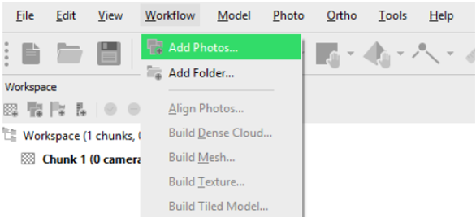
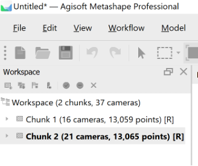
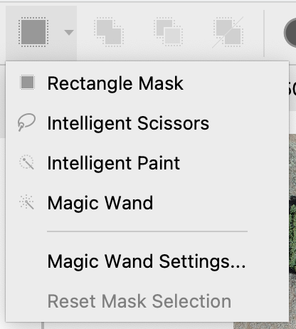
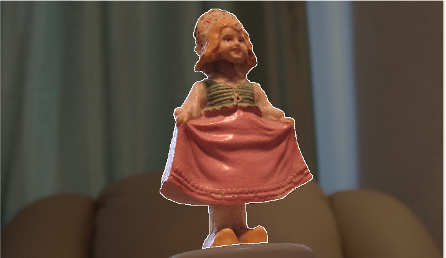
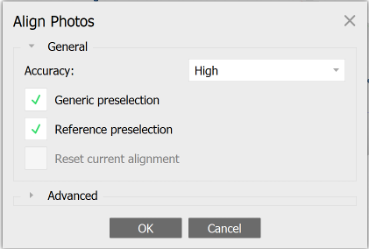
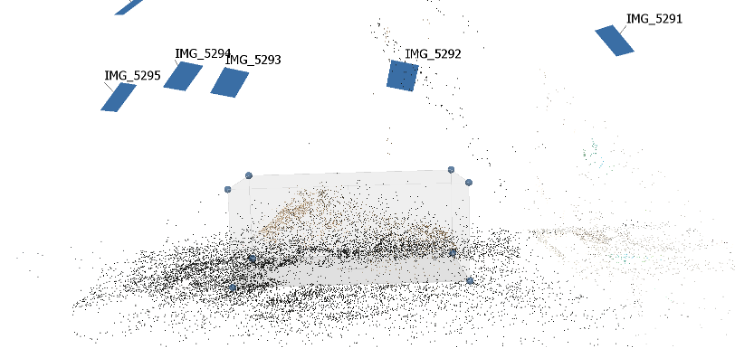
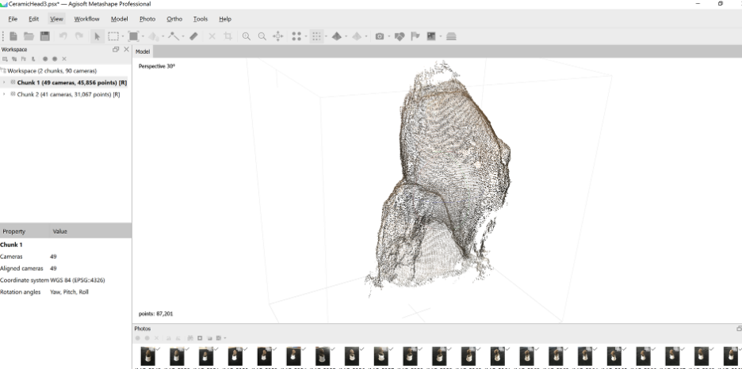
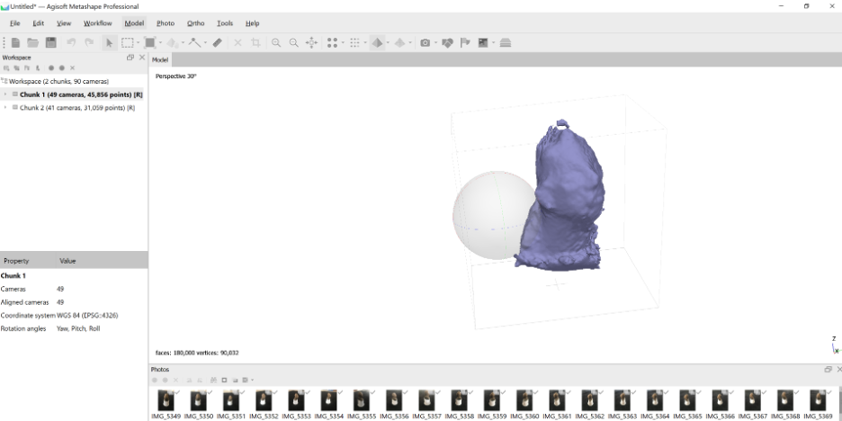
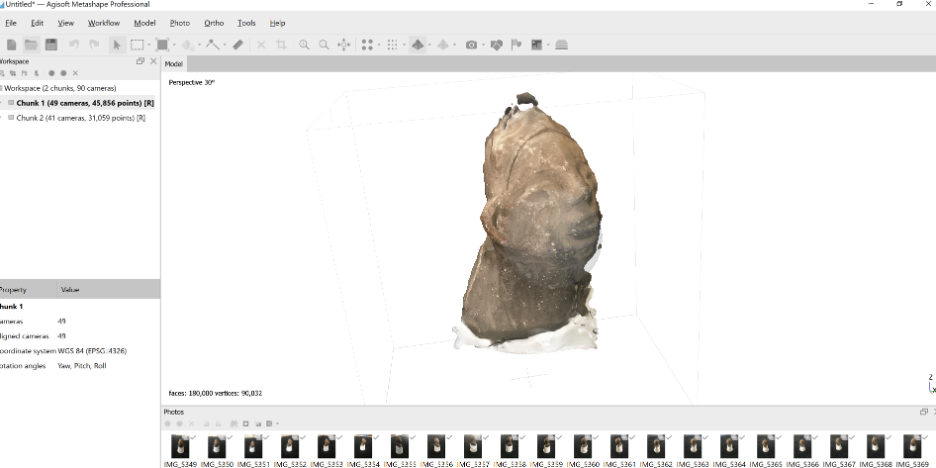

## Set-up

Load your photos onto your computer and open Metashape. You will be working in a new project, a file that will save all the processing steps you undertake. You should save the project with a sensible name on your computer.

## Add Photos

Before adding Photos, carefully review them in a photo editor or viewer. Do not use any photos that are blurry, have bad lighting, or have too much background junk.

To add photos select the `Add Photos...` command from Workflow menu or click `Add Photos` button on Workspace toolbar. In the `Add Photos` dialog, browse the source folder and select files to be processed.

Select only the photos from one side of an object for now and click the `Open` button.

In the lower lefthand corner of the software window, be sure you have selected the `Workspace` tab.

Put all the photos of each side of an object into a separate “Chunk”.

::: callout-note
Each chunk will need to be aligned and have a dense cloud generated independently.
:::

{fig-align="center" width="60%"}

## Mask Photos {#mask}

::: callout-caution
You may not need this step if your photos do not contain much background.
:::

If your photos have a lot of extraneous background, you may need to “mask” this out. Open a photo in Photo View by double-clicking on the photo in the Photos pane.

Locate `Mask` tools in the Toolbar and use one of the tools.

{fig-align="center" width="50%"}

::: callout-note
Rectangular Selection (![icon16_select_rect.png](data:image/png;base64,iVBORw0KGgoAAAANSUhEUgAAABAAAAAQCAYAAAAf8/9hAAAACXBIWXMAAAsTAAALEwEAmpwYAAAKT2lDQ1BQaG90b3Nob3AgSUNDIHByb2ZpbGUAAHjanVNnVFPpFj333vRCS4iAlEtvUhUIIFJCi4AUkSYqIQkQSoghodkVUcERRUUEG8igiAOOjoCMFVEsDIoK2AfkIaKOg6OIisr74Xuja9a89+bN/rXXPues852zzwfACAyWSDNRNYAMqUIeEeCDx8TG4eQuQIEKJHAAEAizZCFz/SMBAPh+PDwrIsAHvgABeNMLCADATZvAMByH/w/qQplcAYCEAcB0kThLCIAUAEB6jkKmAEBGAYCdmCZTAKAEAGDLY2LjAFAtAGAnf+bTAICd+Jl7AQBblCEVAaCRACATZYhEAGg7AKzPVopFAFgwABRmS8Q5ANgtADBJV2ZIALC3AMDOEAuyAAgMADBRiIUpAAR7AGDIIyN4AISZABRG8lc88SuuEOcqAAB4mbI8uSQ5RYFbCC1xB1dXLh4ozkkXKxQ2YQJhmkAuwnmZGTKBNA/g88wAAKCRFRHgg/P9eM4Ors7ONo62Dl8t6r8G/yJiYuP+5c+rcEAAAOF0ftH+LC+zGoA7BoBt/qIl7gRoXgugdfeLZrIPQLUAoOnaV/Nw+H48PEWhkLnZ2eXk5NhKxEJbYcpXff5nwl/AV/1s+X48/Pf14L7iJIEyXYFHBPjgwsz0TKUcz5IJhGLc5o9H/LcL//wd0yLESWK5WCoU41EScY5EmozzMqUiiUKSKcUl0v9k4t8s+wM+3zUAsGo+AXuRLahdYwP2SycQWHTA4vcAAPK7b8HUKAgDgGiD4c93/+8//UegJQCAZkmScQAAXkQkLlTKsz/HCAAARKCBKrBBG/TBGCzABhzBBdzBC/xgNoRCJMTCQhBCCmSAHHJgKayCQiiGzbAdKmAv1EAdNMBRaIaTcA4uwlW4Dj1wD/phCJ7BKLyBCQRByAgTYSHaiAFiilgjjggXmYX4IcFIBBKLJCDJiBRRIkuRNUgxUopUIFVIHfI9cgI5h1xGupE7yAAygvyGvEcxlIGyUT3UDLVDuag3GoRGogvQZHQxmo8WoJvQcrQaPYw2oefQq2gP2o8+Q8cwwOgYBzPEbDAuxsNCsTgsCZNjy7EirAyrxhqwVqwDu4n1Y8+xdwQSgUXACTYEd0IgYR5BSFhMWE7YSKggHCQ0EdoJNwkDhFHCJyKTqEu0JroR+cQYYjIxh1hILCPWEo8TLxB7iEPENyQSiUMyJ7mQAkmxpFTSEtJG0m5SI+ksqZs0SBojk8naZGuyBzmULCAryIXkneTD5DPkG+Qh8lsKnWJAcaT4U+IoUspqShnlEOU05QZlmDJBVaOaUt2ooVQRNY9aQq2htlKvUYeoEzR1mjnNgxZJS6WtopXTGmgXaPdpr+h0uhHdlR5Ol9BX0svpR+iX6AP0dwwNhhWDx4hnKBmbGAcYZxl3GK+YTKYZ04sZx1QwNzHrmOeZD5lvVVgqtip8FZHKCpVKlSaVGyovVKmqpqreqgtV81XLVI+pXlN9rkZVM1PjqQnUlqtVqp1Q61MbU2epO6iHqmeob1Q/pH5Z/YkGWcNMw09DpFGgsV/jvMYgC2MZs3gsIWsNq4Z1gTXEJrHN2Xx2KruY/R27iz2qqaE5QzNKM1ezUvOUZj8H45hx+Jx0TgnnKKeX836K3hTvKeIpG6Y0TLkxZVxrqpaXllirSKtRq0frvTau7aedpr1Fu1n7gQ5Bx0onXCdHZ4/OBZ3nU9lT3acKpxZNPTr1ri6qa6UbobtEd79up+6Ynr5egJ5Mb6feeb3n+hx9L/1U/W36p/VHDFgGswwkBtsMzhg8xTVxbzwdL8fb8VFDXcNAQ6VhlWGX4YSRudE8o9VGjUYPjGnGXOMk423GbcajJgYmISZLTepN7ppSTbmmKaY7TDtMx83MzaLN1pk1mz0x1zLnm+eb15vft2BaeFostqi2uGVJsuRaplnutrxuhVo5WaVYVVpds0atna0l1rutu6cRp7lOk06rntZnw7Dxtsm2qbcZsOXYBtuutm22fWFnYhdnt8Wuw+6TvZN9un2N/T0HDYfZDqsdWh1+c7RyFDpWOt6azpzuP33F9JbpL2dYzxDP2DPjthPLKcRpnVOb00dnF2e5c4PziIuJS4LLLpc+Lpsbxt3IveRKdPVxXeF60vWdm7Obwu2o26/uNu5p7ofcn8w0nymeWTNz0MPIQ+BR5dE/C5+VMGvfrH5PQ0+BZ7XnIy9jL5FXrdewt6V3qvdh7xc+9j5yn+M+4zw33jLeWV/MN8C3yLfLT8Nvnl+F30N/I/9k/3r/0QCngCUBZwOJgUGBWwL7+Hp8Ib+OPzrbZfay2e1BjKC5QRVBj4KtguXBrSFoyOyQrSH355jOkc5pDoVQfujW0Adh5mGLw34MJ4WHhVeGP45wiFga0TGXNXfR3ENz30T6RJZE3ptnMU85ry1KNSo+qi5qPNo3ujS6P8YuZlnM1VidWElsSxw5LiquNm5svt/87fOH4p3iC+N7F5gvyF1weaHOwvSFpxapLhIsOpZATIhOOJTwQRAqqBaMJfITdyWOCnnCHcJnIi/RNtGI2ENcKh5O8kgqTXqS7JG8NXkkxTOlLOW5hCepkLxMDUzdmzqeFpp2IG0yPTq9MYOSkZBxQqohTZO2Z+pn5mZ2y6xlhbL+xW6Lty8elQfJa7OQrAVZLQq2QqboVFoo1yoHsmdlV2a/zYnKOZarnivN7cyzytuQN5zvn//tEsIS4ZK2pYZLVy0dWOa9rGo5sjxxedsK4xUFK4ZWBqw8uIq2Km3VT6vtV5eufr0mek1rgV7ByoLBtQFr6wtVCuWFfevc1+1dT1gvWd+1YfqGnRs+FYmKrhTbF5cVf9go3HjlG4dvyr+Z3JS0qavEuWTPZtJm6ebeLZ5bDpaql+aXDm4N2dq0Dd9WtO319kXbL5fNKNu7g7ZDuaO/PLi8ZafJzs07P1SkVPRU+lQ27tLdtWHX+G7R7ht7vPY07NXbW7z3/T7JvttVAVVN1WbVZftJ+7P3P66Jqun4lvttXa1ObXHtxwPSA/0HIw6217nU1R3SPVRSj9Yr60cOxx++/p3vdy0NNg1VjZzG4iNwRHnk6fcJ3/ceDTradox7rOEH0x92HWcdL2pCmvKaRptTmvtbYlu6T8w+0dbq3nr8R9sfD5w0PFl5SvNUyWna6YLTk2fyz4ydlZ19fi753GDborZ752PO32oPb++6EHTh0kX/i+c7vDvOXPK4dPKy2+UTV7hXmq86X23qdOo8/pPTT8e7nLuarrlca7nuer21e2b36RueN87d9L158Rb/1tWeOT3dvfN6b/fF9/XfFt1+cif9zsu72Xcn7q28T7xf9EDtQdlD3YfVP1v+3Njv3H9qwHeg89HcR/cGhYPP/pH1jw9DBY+Zj8uGDYbrnjg+OTniP3L96fynQ89kzyaeF/6i/suuFxYvfvjV69fO0ZjRoZfyl5O/bXyl/erA6xmv28bCxh6+yXgzMV70VvvtwXfcdx3vo98PT+R8IH8o/2j5sfVT0Kf7kxmTk/8EA5jz/GMzLdsAAAAgY0hSTQAAeiUAAICDAAD5/wAAgOkAAHUwAADqYAAAOpgAABdvkl/FRgAAAM5JREFUeNrEkzGOhDAMRX8yXAKuwA0o6BE1PRUHQFxgRAviFHAfbkMcJ3+KkbbfZKW1ZMnNf7aeZEMSOVUcx0GSiDFiWRYDAOu6UlWhqgghQFWxbZsBgGma6L2HiOA8T4N930kSv+1hGEgSNsaYdLqIfIeU7STR9z1JwuRKfBVFwbZt36kAG0JICjZNQwCwqvo/Euu6/huJdp7nLIL13icFy7LMk+ic+z6TqmIcR4oIrusyANB1HUUEzjk45yAiuO/bAEBVVXye5weQLfEzAAeO+8dDwsYYAAAAAElFTkSuQmCC){alt="icon16_select_rect.png"}) for rectangular shape irrelevant elements; Intelligent Scissors (![icon16_lasso.png](data:image/png;base64,iVBORw0KGgoAAAANSUhEUgAAABAAAAAQCAYAAAAf8/9hAAAAGXRFWHRTb2Z0d2FyZQBBZG9iZSBJbWFnZVJlYWR5ccllPAAAAwJJREFUeNqUUmtIU2EYfs/xpDbzFhZazpYgpmZZYCn+iOqH+kuICksyxdJI7I+XwhuZFURQGYFaaZJdvOWGYRfNaQlOfzg1dWe4zB3dRTA3p2e3c9zWd+YMIQh74D0f53uf9/Y9L+ZwOIDD2+ZWSIiPg4HBIYiOiuRRs1Qew9pO4Rh2xGq1IAYGGI4BQWxZccPxWsEefoWVYWkCXEBE5HQLdHf3+CwdGTuwsPALdLpFqVqjfqSYmpIiN+a5lee7Lzz8mECwt4Cm6YKIiIgYbL0Doeh92TJtuKWaU4N0eLi8/V3rB3RNI1tynRy4gn7IAoqul3TFxh5mCKGoA7y9tz1RKmdySblc/Ky2uggRlNk5VxdRJTCZjbCo08Pq6ipYzGZ42VBnQH4q9Vzaw5CQ4EqC58U7Ozo2ltvf/62+QyS6m3o+fXq7vx8YaSOwqyzYbDZgrAxcysqEuKOx6xNDSkrK6a7u7llCr9NVjY6O/ETB5WgcNefsEffCyRPHobHxtTNB8O5dYGEszsD6Fw2oY+9iipo9qFapSnGNRhNoMlvb1oM5mEwm58myax3Y7XZOA+cdj+dVMq/V3kFFv3Z3farBJYNDVHJiUua6GNwHwzDYCBzHwdPTM/Lp87pphNuSoUFRc9ObrAsXMxYJuZwsPBQT09L4qsnB2hiUAQM+P/g+iruBNI92OOxp6DJH3CP20ev1VGdnZ4ZscrzvcvYVyoL2gyvFa2sXquQk6a9Rq8HH1w8EAgFYLWaYU2nQCCwsLRn6BiUDDSQpG0b8mdy8a0aWYcGMOERxSZlJMiBh9kdFAjjsELBj58dJ2WTyHEWli0RCmWsKbhfmb1ZUGqVSKcCGCQlSRsL4xPdMml4RBgUFeWi12uSJ8YkHveIv7SWl5UaGtaJuGFAoFH+9zZ9H+6GYEtfWVMevLBugpbkpCQXfq6p6bIRNgAgLC4XCwkIrkjGRW2uSJMWnz6SyXDGuIgbYvxNwOrs0T0D6t+Tn57Pcv1KpXCO4e8BmEYqMD/+J3wIMAMrHfUiNNhMhAAAAAElFTkSuQmCC){alt="icon16_lasso.png"}) selects irregular shaped area in the photo; Intelligent Paint (![icon16_intelligent_paint.png](data:image/png;base64,iVBORw0KGgoAAAANSUhEUgAAABAAAAAQCAYAAAAf8/9hAAAACXBIWXMAAAsTAAALEwEAmpwYAAAKT2lDQ1BQaG90b3Nob3AgSUNDIHByb2ZpbGUAAHjanVNnVFPpFj333vRCS4iAlEtvUhUIIFJCi4AUkSYqIQkQSoghodkVUcERRUUEG8igiAOOjoCMFVEsDIoK2AfkIaKOg6OIisr74Xuja9a89+bN/rXXPues852zzwfACAyWSDNRNYAMqUIeEeCDx8TG4eQuQIEKJHAAEAizZCFz/SMBAPh+PDwrIsAHvgABeNMLCADATZvAMByH/w/qQplcAYCEAcB0kThLCIAUAEB6jkKmAEBGAYCdmCZTAKAEAGDLY2LjAFAtAGAnf+bTAICd+Jl7AQBblCEVAaCRACATZYhEAGg7AKzPVopFAFgwABRmS8Q5ANgtADBJV2ZIALC3AMDOEAuyAAgMADBRiIUpAAR7AGDIIyN4AISZABRG8lc88SuuEOcqAAB4mbI8uSQ5RYFbCC1xB1dXLh4ozkkXKxQ2YQJhmkAuwnmZGTKBNA/g88wAAKCRFRHgg/P9eM4Ors7ONo62Dl8t6r8G/yJiYuP+5c+rcEAAAOF0ftH+LC+zGoA7BoBt/qIl7gRoXgugdfeLZrIPQLUAoOnaV/Nw+H48PEWhkLnZ2eXk5NhKxEJbYcpXff5nwl/AV/1s+X48/Pf14L7iJIEyXYFHBPjgwsz0TKUcz5IJhGLc5o9H/LcL//wd0yLESWK5WCoU41EScY5EmozzMqUiiUKSKcUl0v9k4t8s+wM+3zUAsGo+AXuRLahdYwP2SycQWHTA4vcAAPK7b8HUKAgDgGiD4c93/+8//UegJQCAZkmScQAAXkQkLlTKsz/HCAAARKCBKrBBG/TBGCzABhzBBdzBC/xgNoRCJMTCQhBCCmSAHHJgKayCQiiGzbAdKmAv1EAdNMBRaIaTcA4uwlW4Dj1wD/phCJ7BKLyBCQRByAgTYSHaiAFiilgjjggXmYX4IcFIBBKLJCDJiBRRIkuRNUgxUopUIFVIHfI9cgI5h1xGupE7yAAygvyGvEcxlIGyUT3UDLVDuag3GoRGogvQZHQxmo8WoJvQcrQaPYw2oefQq2gP2o8+Q8cwwOgYBzPEbDAuxsNCsTgsCZNjy7EirAyrxhqwVqwDu4n1Y8+xdwQSgUXACTYEd0IgYR5BSFhMWE7YSKggHCQ0EdoJNwkDhFHCJyKTqEu0JroR+cQYYjIxh1hILCPWEo8TLxB7iEPENyQSiUMyJ7mQAkmxpFTSEtJG0m5SI+ksqZs0SBojk8naZGuyBzmULCAryIXkneTD5DPkG+Qh8lsKnWJAcaT4U+IoUspqShnlEOU05QZlmDJBVaOaUt2ooVQRNY9aQq2htlKvUYeoEzR1mjnNgxZJS6WtopXTGmgXaPdpr+h0uhHdlR5Ol9BX0svpR+iX6AP0dwwNhhWDx4hnKBmbGAcYZxl3GK+YTKYZ04sZx1QwNzHrmOeZD5lvVVgqtip8FZHKCpVKlSaVGyovVKmqpqreqgtV81XLVI+pXlN9rkZVM1PjqQnUlqtVqp1Q61MbU2epO6iHqmeob1Q/pH5Z/YkGWcNMw09DpFGgsV/jvMYgC2MZs3gsIWsNq4Z1gTXEJrHN2Xx2KruY/R27iz2qqaE5QzNKM1ezUvOUZj8H45hx+Jx0TgnnKKeX836K3hTvKeIpG6Y0TLkxZVxrqpaXllirSKtRq0frvTau7aedpr1Fu1n7gQ5Bx0onXCdHZ4/OBZ3nU9lT3acKpxZNPTr1ri6qa6UbobtEd79up+6Ynr5egJ5Mb6feeb3n+hx9L/1U/W36p/VHDFgGswwkBtsMzhg8xTVxbzwdL8fb8VFDXcNAQ6VhlWGX4YSRudE8o9VGjUYPjGnGXOMk423GbcajJgYmISZLTepN7ppSTbmmKaY7TDtMx83MzaLN1pk1mz0x1zLnm+eb15vft2BaeFostqi2uGVJsuRaplnutrxuhVo5WaVYVVpds0atna0l1rutu6cRp7lOk06rntZnw7Dxtsm2qbcZsOXYBtuutm22fWFnYhdnt8Wuw+6TvZN9un2N/T0HDYfZDqsdWh1+c7RyFDpWOt6azpzuP33F9JbpL2dYzxDP2DPjthPLKcRpnVOb00dnF2e5c4PziIuJS4LLLpc+Lpsbxt3IveRKdPVxXeF60vWdm7Obwu2o26/uNu5p7ofcn8w0nymeWTNz0MPIQ+BR5dE/C5+VMGvfrH5PQ0+BZ7XnIy9jL5FXrdewt6V3qvdh7xc+9j5yn+M+4zw33jLeWV/MN8C3yLfLT8Nvnl+F30N/I/9k/3r/0QCngCUBZwOJgUGBWwL7+Hp8Ib+OPzrbZfay2e1BjKC5QRVBj4KtguXBrSFoyOyQrSH355jOkc5pDoVQfujW0Adh5mGLw34MJ4WHhVeGP45wiFga0TGXNXfR3ENz30T6RJZE3ptnMU85ry1KNSo+qi5qPNo3ujS6P8YuZlnM1VidWElsSxw5LiquNm5svt/87fOH4p3iC+N7F5gvyF1weaHOwvSFpxapLhIsOpZATIhOOJTwQRAqqBaMJfITdyWOCnnCHcJnIi/RNtGI2ENcKh5O8kgqTXqS7JG8NXkkxTOlLOW5hCepkLxMDUzdmzqeFpp2IG0yPTq9MYOSkZBxQqohTZO2Z+pn5mZ2y6xlhbL+xW6Lty8elQfJa7OQrAVZLQq2QqboVFoo1yoHsmdlV2a/zYnKOZarnivN7cyzytuQN5zvn//tEsIS4ZK2pYZLVy0dWOa9rGo5sjxxedsK4xUFK4ZWBqw8uIq2Km3VT6vtV5eufr0mek1rgV7ByoLBtQFr6wtVCuWFfevc1+1dT1gvWd+1YfqGnRs+FYmKrhTbF5cVf9go3HjlG4dvyr+Z3JS0qavEuWTPZtJm6ebeLZ5bDpaql+aXDm4N2dq0Dd9WtO319kXbL5fNKNu7g7ZDuaO/PLi8ZafJzs07P1SkVPRU+lQ27tLdtWHX+G7R7ht7vPY07NXbW7z3/T7JvttVAVVN1WbVZftJ+7P3P66Jqun4lvttXa1ObXHtxwPSA/0HIw6217nU1R3SPVRSj9Yr60cOxx++/p3vdy0NNg1VjZzG4iNwRHnk6fcJ3/ceDTradox7rOEH0x92HWcdL2pCmvKaRptTmvtbYlu6T8w+0dbq3nr8R9sfD5w0PFl5SvNUyWna6YLTk2fyz4ydlZ19fi753GDborZ752PO32oPb++6EHTh0kX/i+c7vDvOXPK4dPKy2+UTV7hXmq86X23qdOo8/pPTT8e7nLuarrlca7nuer21e2b36RueN87d9L158Rb/1tWeOT3dvfN6b/fF9/XfFt1+cif9zsu72Xcn7q28T7xf9EDtQdlD3YfVP1v+3Njv3H9qwHeg89HcR/cGhYPP/pH1jw9DBY+Zj8uGDYbrnjg+OTniP3L96fynQ89kzyaeF/6i/suuFxYvfvjV69fO0ZjRoZfyl5O/bXyl/erA6xmv28bCxh6+yXgzMV70VvvtwXfcdx3vo98PT+R8IH8o/2j5sfVT0Kf7kxmTk/8EA5jz/GMzLdsAAAAgY0hSTQAAeiUAAICDAAD5/wAAgOkAAHUwAADqYAAAOpgAABdvkl/FRgAAAWZJREFUeNqck79LAmEcxp+zKAVv8zb/h8CttRLXVGhpqClPqEnCyOASDCQM3aOhllD8EQpyvoMKetzQEDQdtGlzQ//A06R4p3dRDzzwhS98vu/zfd9XIomZCmaRAHC1fSHl+hoB4GYnL8FD0iIAAHq9HgEgFotJi7UrgSSuxwWShJszjaxr3+ecPNOxLPNUljltNllKFCVn33YCkhBC2KYcBYN839ultbXFSb3ufYJcX2M0GpUcy8Hn2jq+IhEU3r5dV+Bza8Qf7lEbjzE9OMN0MkEiXfGOsMqi0yYApvM1CsNiUi0tRfl1y41miwBYeRpQGBb3T+64EqDruiuk1XphOBxmSqty+PrBw/NH2gAk4QUgiXanQ0VReHn7TGFYjKtl2gDOR5NpZOmM1u126fcH5pCkWlqepOv6PM5iPfNwOODGZoBxtUxhWPS8BTePjBFDoRBTWvV/AJIwTZOKonDpN/5VPwMASioEGdpwzO4AAAAASUVORK5CYII=){alt="icon16_intelligent_paint.png"}) paints the selection with the mouse. Magic Wand (![icon16_magic_wand.png](data:image/png;base64,iVBORw0KGgoAAAANSUhEUgAAABAAAAAQCAYAAAAf8/9hAAAACXBIWXMAAAsTAAALEwEAmpwYAAAKT2lDQ1BQaG90b3Nob3AgSUNDIHByb2ZpbGUAAHjanVNnVFPpFj333vRCS4iAlEtvUhUIIFJCi4AUkSYqIQkQSoghodkVUcERRUUEG8igiAOOjoCMFVEsDIoK2AfkIaKOg6OIisr74Xuja9a89+bN/rXXPues852zzwfACAyWSDNRNYAMqUIeEeCDx8TG4eQuQIEKJHAAEAizZCFz/SMBAPh+PDwrIsAHvgABeNMLCADATZvAMByH/w/qQplcAYCEAcB0kThLCIAUAEB6jkKmAEBGAYCdmCZTAKAEAGDLY2LjAFAtAGAnf+bTAICd+Jl7AQBblCEVAaCRACATZYhEAGg7AKzPVopFAFgwABRmS8Q5ANgtADBJV2ZIALC3AMDOEAuyAAgMADBRiIUpAAR7AGDIIyN4AISZABRG8lc88SuuEOcqAAB4mbI8uSQ5RYFbCC1xB1dXLh4ozkkXKxQ2YQJhmkAuwnmZGTKBNA/g88wAAKCRFRHgg/P9eM4Ors7ONo62Dl8t6r8G/yJiYuP+5c+rcEAAAOF0ftH+LC+zGoA7BoBt/qIl7gRoXgugdfeLZrIPQLUAoOnaV/Nw+H48PEWhkLnZ2eXk5NhKxEJbYcpXff5nwl/AV/1s+X48/Pf14L7iJIEyXYFHBPjgwsz0TKUcz5IJhGLc5o9H/LcL//wd0yLESWK5WCoU41EScY5EmozzMqUiiUKSKcUl0v9k4t8s+wM+3zUAsGo+AXuRLahdYwP2SycQWHTA4vcAAPK7b8HUKAgDgGiD4c93/+8//UegJQCAZkmScQAAXkQkLlTKsz/HCAAARKCBKrBBG/TBGCzABhzBBdzBC/xgNoRCJMTCQhBCCmSAHHJgKayCQiiGzbAdKmAv1EAdNMBRaIaTcA4uwlW4Dj1wD/phCJ7BKLyBCQRByAgTYSHaiAFiilgjjggXmYX4IcFIBBKLJCDJiBRRIkuRNUgxUopUIFVIHfI9cgI5h1xGupE7yAAygvyGvEcxlIGyUT3UDLVDuag3GoRGogvQZHQxmo8WoJvQcrQaPYw2oefQq2gP2o8+Q8cwwOgYBzPEbDAuxsNCsTgsCZNjy7EirAyrxhqwVqwDu4n1Y8+xdwQSgUXACTYEd0IgYR5BSFhMWE7YSKggHCQ0EdoJNwkDhFHCJyKTqEu0JroR+cQYYjIxh1hILCPWEo8TLxB7iEPENyQSiUMyJ7mQAkmxpFTSEtJG0m5SI+ksqZs0SBojk8naZGuyBzmULCAryIXkneTD5DPkG+Qh8lsKnWJAcaT4U+IoUspqShnlEOU05QZlmDJBVaOaUt2ooVQRNY9aQq2htlKvUYeoEzR1mjnNgxZJS6WtopXTGmgXaPdpr+h0uhHdlR5Ol9BX0svpR+iX6AP0dwwNhhWDx4hnKBmbGAcYZxl3GK+YTKYZ04sZx1QwNzHrmOeZD5lvVVgqtip8FZHKCpVKlSaVGyovVKmqpqreqgtV81XLVI+pXlN9rkZVM1PjqQnUlqtVqp1Q61MbU2epO6iHqmeob1Q/pH5Z/YkGWcNMw09DpFGgsV/jvMYgC2MZs3gsIWsNq4Z1gTXEJrHN2Xx2KruY/R27iz2qqaE5QzNKM1ezUvOUZj8H45hx+Jx0TgnnKKeX836K3hTvKeIpG6Y0TLkxZVxrqpaXllirSKtRq0frvTau7aedpr1Fu1n7gQ5Bx0onXCdHZ4/OBZ3nU9lT3acKpxZNPTr1ri6qa6UbobtEd79up+6Ynr5egJ5Mb6feeb3n+hx9L/1U/W36p/VHDFgGswwkBtsMzhg8xTVxbzwdL8fb8VFDXcNAQ6VhlWGX4YSRudE8o9VGjUYPjGnGXOMk423GbcajJgYmISZLTepN7ppSTbmmKaY7TDtMx83MzaLN1pk1mz0x1zLnm+eb15vft2BaeFostqi2uGVJsuRaplnutrxuhVo5WaVYVVpds0atna0l1rutu6cRp7lOk06rntZnw7Dxtsm2qbcZsOXYBtuutm22fWFnYhdnt8Wuw+6TvZN9un2N/T0HDYfZDqsdWh1+c7RyFDpWOt6azpzuP33F9JbpL2dYzxDP2DPjthPLKcRpnVOb00dnF2e5c4PziIuJS4LLLpc+Lpsbxt3IveRKdPVxXeF60vWdm7Obwu2o26/uNu5p7ofcn8w0nymeWTNz0MPIQ+BR5dE/C5+VMGvfrH5PQ0+BZ7XnIy9jL5FXrdewt6V3qvdh7xc+9j5yn+M+4zw33jLeWV/MN8C3yLfLT8Nvnl+F30N/I/9k/3r/0QCngCUBZwOJgUGBWwL7+Hp8Ib+OPzrbZfay2e1BjKC5QRVBj4KtguXBrSFoyOyQrSH355jOkc5pDoVQfujW0Adh5mGLw34MJ4WHhVeGP45wiFga0TGXNXfR3ENz30T6RJZE3ptnMU85ry1KNSo+qi5qPNo3ujS6P8YuZlnM1VidWElsSxw5LiquNm5svt/87fOH4p3iC+N7F5gvyF1weaHOwvSFpxapLhIsOpZATIhOOJTwQRAqqBaMJfITdyWOCnnCHcJnIi/RNtGI2ENcKh5O8kgqTXqS7JG8NXkkxTOlLOW5hCepkLxMDUzdmzqeFpp2IG0yPTq9MYOSkZBxQqohTZO2Z+pn5mZ2y6xlhbL+xW6Lty8elQfJa7OQrAVZLQq2QqboVFoo1yoHsmdlV2a/zYnKOZarnivN7cyzytuQN5zvn//tEsIS4ZK2pYZLVy0dWOa9rGo5sjxxedsK4xUFK4ZWBqw8uIq2Km3VT6vtV5eufr0mek1rgV7ByoLBtQFr6wtVCuWFfevc1+1dT1gvWd+1YfqGnRs+FYmKrhTbF5cVf9go3HjlG4dvyr+Z3JS0qavEuWTPZtJm6ebeLZ5bDpaql+aXDm4N2dq0Dd9WtO319kXbL5fNKNu7g7ZDuaO/PLi8ZafJzs07P1SkVPRU+lQ27tLdtWHX+G7R7ht7vPY07NXbW7z3/T7JvttVAVVN1WbVZftJ+7P3P66Jqun4lvttXa1ObXHtxwPSA/0HIw6217nU1R3SPVRSj9Yr60cOxx++/p3vdy0NNg1VjZzG4iNwRHnk6fcJ3/ceDTradox7rOEH0x92HWcdL2pCmvKaRptTmvtbYlu6T8w+0dbq3nr8R9sfD5w0PFl5SvNUyWna6YLTk2fyz4ydlZ19fi753GDborZ752PO32oPb++6EHTh0kX/i+c7vDvOXPK4dPKy2+UTV7hXmq86X23qdOo8/pPTT8e7nLuarrlca7nuer21e2b36RueN87d9L158Rb/1tWeOT3dvfN6b/fF9/XfFt1+cif9zsu72Xcn7q28T7xf9EDtQdlD3YfVP1v+3Njv3H9qwHeg89HcR/cGhYPP/pH1jw9DBY+Zj8uGDYbrnjg+OTniP3L96fynQ89kzyaeF/6i/suuFxYvfvjV69fO0ZjRoZfyl5O/bXyl/erA6xmv28bCxh6+yXgzMV70VvvtwXfcdx3vo98PT+R8IH8o/2j5sfVT0Kf7kxmTk/8EA5jz/GMzLdsAAAAgY0hSTQAAeiUAAICDAAD5/wAAgOkAAHUwAADqYAAAOpgAABdvkl/FRgAAAYRJREFUeNpi/P//PwMlgAmXxLlV0/+TZMD59XNRNHw/sw9FIbo8DDAie+HM4r7/kkrvGfh0dRl4+cIYPn9YyfDh8mWGF/eFGEzjihgJekFC6R2DNEMLAy+fPMP500cYeAUUGGSZWhnEFd7g9sP////h+NP7Ff///z/x/38Ww///Dz0g9P8T/z+8W/ofWR0yZji7ctr/4135//cn2/7//////5PH9kE050AMObBn6///////35Ng/f9Ie+7/08smoxiGYtrH98uxuuDt68W4XYDMubev7P//IxBNe3ZshBh2guH/9e35OA1ACcTnd4UY7nwvZnj35jaDs7sfw9vXtxiuvs1heHqLn8FTQ+4/3kA8vXoWii27sr0R/AkM/0+XhP331pL7j9MFJiGpKPHMbmiP4OT/Z2QXlmTozoxn8NGW/48zIREClzsK/v/59oWhdu1uhi1XHzLizQvYgG7FBEYWLh6GKCNVuEsYycmNlzsK/l++eoVh2bnb5BkAM+T0hYsMgAEAyNhP17YrLSMAAAAASUVORK5CYII=){alt="icon16_magic_wand.png"}) tool masks uniform background of the image. To use it, click the Magic Wand tool, then click inside the uniform area to be masked.
:::

{fig-align="center" width="80%"}

Save the mask by clicking Add Selection ({alt="icon16_selection_add.png"}) button from the Toolbar.

Repeat the described procedure for every photo where background needs to be masked.

::: callout-tip
For some additional help on easier masking operations, check out this video: <https://www.youtube.com/watch?v=feOo3KI-J-U>
:::

::: callout-note
Read more about masking photos from Agisoft’s own tutorial: <https://agisoft.freshdesk.com/support/solutions/articles/31000153479-masks>
:::

## Align Photos

At this stage Metashape estimates the camera position for each photo and builds the sparse point cloud model.

Select `Align Photos` command from the `Workflow`menu.

{fig-align="center" width="50%"}

Set the following recommended values for the parameters in the *Align Photos* dialogue:

- **`Accuracy`**: High or Medium (lower accuracy settings can be used to get the rough camera positions in the shorter time)

- **`Key point limit`**: 40000

- **`Tie point limit`**:1000

Click `OK` button to start photo alignment.

Create a new chuck for each set of photos that are taken from a different perspective and follow the same steps as above.

## Set Bounding Box

After photo alignment is finished you should see a sparse point cloud showing your object with a box around it.

Resize the bounding box position and orientation to fit the object, as it defines the limits of the area to be modeled.

{fig-align="center" width="80%"}

## Build Dense Cloud

Based on the estimated camera positions, Metashape now creates a single dense point cloud.

Select `Build Dense Cloud` command from the `Workflow` menu.

::: callout-note
You will need to do this procedure for each chunk in your model.
:::

Set the following recommended values for the parameters in the `Build Dense Cloud`dialogue:

- **`Quality`**: Medium (higher quality takes quite a long time and demands more computational resources)

- **`Depth filtering`**: Aggressive (if the geometry of the scene to be reconstructed is complex with numerous small details on the foreground, then it is recommended to set to Mild depth filtering mode, for important features not to be sorted out)

Click `OK` button to start building dense point cloud.

{fig-align="center" width="100%"}

::: callout-tip
You should carefully inspect the resulting point cloud, and use the Rectangle, Circle or other selection tools to manually select bad points and delete them from the model.
:::

## Build a Mesh

After the dense point cloud has been reconstructed it is possible to generate a high-quality polygonal mesh model based on the dense cloud data, basically filling in areas between points in the point cloud to create a continuous surface.

Select `Build Mesh` command from the `Workflow` menu.

Set the following recommended values for the parameters in the `Build Mesh` dialog:

- `Source data`: Dense cloud

- `Surface type`: Arbitrary (3D)

- `Face count`: High (to get a nice model) or Medium (for faster processing)

Click `OK` button to start mesh reconstruction.

{fig-align="center" width="100%"}

When complete notice that you can view the model now either as point cloud or a mesh.

::: callout-tip
If your mesh looks terrible you should back up and clean your point cloud up a bit more.
:::

## Build Texture

Now we will use the color values from the photos to create a textured surface on the blank 3D model.

Select `Build Texture` command from the `Workflow` menu.

Set the following recommended values for the parameters in the `Build Texture` dialogue:

- `Mapping mode`: Generic

- `Blending mode`: Mosaic

- `Texture size/count`: 4096 x 1 (width and height of the texture atlas in pixels and determines the number of files for texture to be exported to. Exporting texture to several files allows to archive greater resolution of the final model texture, while export of high resolution texture to a single file can fail due to RAM limitations)

- `Enable color correction`: disabled

Click `OK` button to start texture generation. When this is done you will have a complete 3D model.

{fig-align="center" width="100%"}

## Align and Merge Chunks

Select `Align Chucks` from the workflow toolbar.

In the dialogue window, select options `Method`: Point Based, `Accuracy`: High, and `Constrain Features by Mask`.

Run the process. HOPEFULLY this step will work automatically. If it does not work however you will need to do some additional fiddling, by manually selecting points in the two chunks to aid in their alignment.

::: callout-tip
Check out this useful video for some added tips on good ways to approach alignment of chunks if the automated method does not work: <https://www.youtube.com/watch?v=Xz27IA-BCcA>
:::

Once the process is complete you will need to use the editor tools to delete unwanted elements in the point cloud from each chunk using the Selection tools located on the Toolbar. Essentially, you will use the top half of one model and the bottom half of the other.

Finally, go back to the Workflow menu and select `Merge Chunks` and in the options, select `Merge Dense Clouds` and `Merge Models`. Run the process.

## Export a Model

After you have saved your Metashape Project, you can export your model to a variety of formats.

Select `Export Model...` command from the `File` menu. In the `Save As...` dialogue select the folder for the model to be saved in and choose preferred file type from the list.

::: callout-important
## Assignment

Export a 3D .pdf to submit with your lab write-up.
:::

If you want to print your object on a 3D printer, you should use a OBJ file format. If you submit a good OBJ file to us, along with a mailing address, we will have your object printed and mail it to you!

In the `Export Model` dialog indicate the desired export parameters. Note that the list of available exporting parameters depends on the selected file format.

Metashape also supports direct model upload to [Sketchfab](#0) resources. To publish your model online use `Upload Data...` command from the File menu.

::: callout-tip
To apply correct model orientation in space use `Rotate Object` tool prior to model upload.
:::

## Further Training for 3D Enthusiasts

Metashape and other digital photogrammetry software packages are rapidly changing many fields of research.

To check out some of the other ways you can use Metashape, a good place to start are their tutorials: <http://www.agisoft.com/support/tutorials/intermediate-level/>

Samantha Porter’s third video also provides good tips on improving texturing of artifacts as well as various methods to add scale to the illustration: <https://www.youtube.com/watch?v=xLYLEpdfLos>

There are dozens of online forums and videos dedicated to different issues and possibilities in the rapidly changing world of digital photogrammetry.

When you are done, navigate to the next page and answer all questions.
