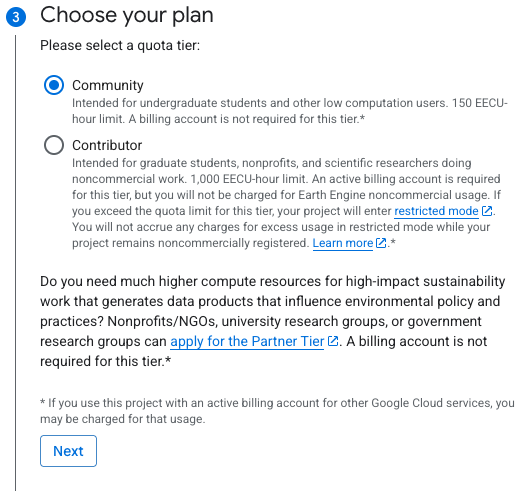
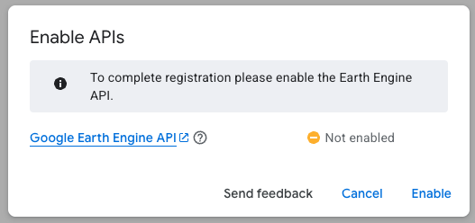

## Introduction

{fig-align="center" width="50%"}

Google Earth Engine (GEE) is a powerful cloud-based platform that allows high-speed, Google-powered spatial analysis using a massive catalog of satellite datasets.

## Registration

First, go to [console.cloud.google.com/earth-engine](https://console.cloud.google.com/earth-engine) and create or select a Cloud project.

After logging in with your Dartmouth credentials, click on `Register` and select `Create project`. Select a unique `Project name` and attach the project to `dartmouth.edu` -\> `Learning` -\> `Students`.

{fig-align="center" width="100%"}

Next, select `Get started` for noncommercial use. In the questionnaire, answer Public or private academic institution for organization type. Type in Dartmouth College as the name of your institution, and select `No`, `Scientific research`, `Archaeology`, `Global`, and finally `No`, before checking for eligibility.

{fig-align="center" width="75%"}

Next, choose `Community` as your plan, which is more than enough for our course. Select a category that describes your work.

After submitting your questionnaire, you may need to enable GEE API. Select `Enable`.

{fig-align="center" width="60%"}

## Code Editor Interface

After registration, you should now have access to the code editor (<https://code.earthengine.google.com/>).
