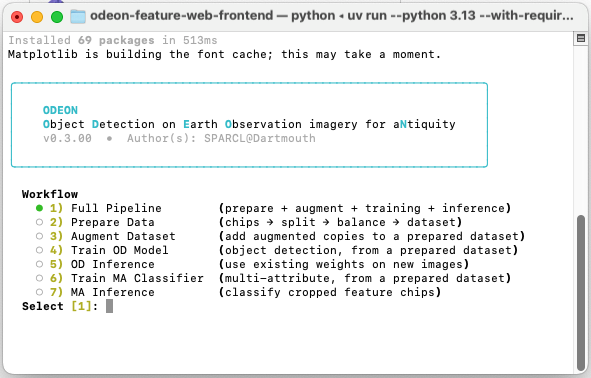
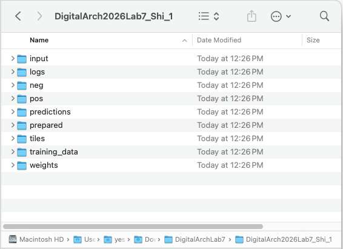
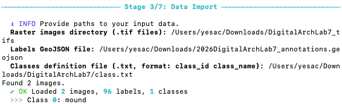
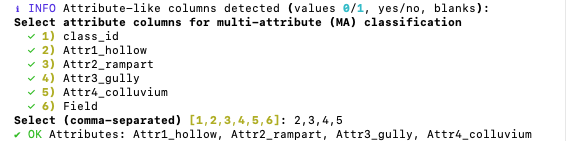
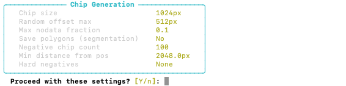
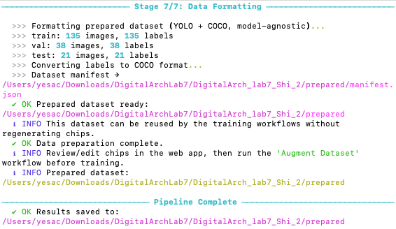
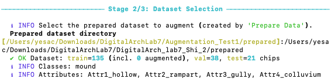

## Project Setup

{fig-align="center" width="80%"}

In ODEON, start with 2) Prepare Data, where you will be guided to enter project configuration information.

- For `Project name`, enter a reasonable name such as `DigitalArch2026Lab7_Name_1`.

- For `Output directory`, give it an *existing* directory, and ODEON will create folders within that directory.

- For `Master random seed`, use the default 42 to make sure that all results are the same across runs.

{fig-align="center" width="80%"}

## Data Import

For Data Import, you will provide rasters and labels.

- For `Raster images directory`, supply the *directory* where you store the `.tif` files, such as `/Users/yesac/Downloads/DigitalArchLab7_tifs` (it may be different in your machine!). ODEON will scan all `.tif` files within that directory for the preparation of training data.

- Next, give ODEON the path to the annotation `.geojson` file, such as `/Users/yesac/Downloads/2026DigitalArchLab7_annotations.geojson`.

- For `Classes definition file`, create a `.txt` file in your computer, and provide its path to ODEON. There should be one line in the `.txt` file:

  ```         
  0 mound
  ```

Successful import should give you the number of images, labels, and classes.

{fig-align="center" width="80%"}

::: callout-tip
If you are having trouble, you can always terminate the program by pressing `ctrl` + `c` and restart the process.
:::

ODEON supports multi-attribute classification, meaning that it can classify a detected site and assign one or multiple attributes to the site. In our annotations, each mound was further labeled for the presence of holloway, walls, erosional gullies, and colluvial aprons. Select `2,3,4,5`, which are the columns that contain attribute labels, for the multi-attribute classification.

{fig-align="center" width="80%"}

Because of the vast geographical extent of HEXAGON scenes, orthorectification can usually result in slightly offset rasters that are overlapping. As such, ODEON supports a `source-image column` where the raster upon which a feature was labeled can be referenced.

For example, all of our training data were annotated using `D3C1204-300451A005_cog.tif`. In our annotation `.geojson` file, we included a `src_img` column that includes this information.

In ODEON, selects `y` to set a source-image column and select `13` (src_img).

## Chip Generation

ODEON supports the generation of "chips" around each labels, offering options such as center offset and hard negatives (human-defined background chips that are easily misclassified).

In Chip Settings, use the following values:

- `Chip size`: 1024 (Most mounds are smaller than this)

- `Random offset`: 512

- `Max nodata fraction`: 0.1 (Any chip that has \>10% nodata pixels will be discarded)

- `Save irregular polygon outlines`: N

For Negative Sampling, use:

- `Number of negative chips`: 100

- `Min distance from positives`: 2048 (double the size of a chip to avoid sampling mounds)

- `Provide hard-negative points`: N

{fig-align="center" width="80%"}

After confirming the settings, proceed by pressing `y`. ODEON should now populate the `pos` and `neg` folders in your project directory with chips. Check if they are correct.

## Data Split and Class Balancing

ODEON supports any ratio of data split with stratification (*i.e.*, all classes are proportionally represented in the three dataset). We will be using a typical 0.7-0.2-0.1 train-val-test split for this case.

Because we only created 100 negative, background chips, no class balancing strategies are needed.

{fig-align="center" width="80%"}

Once this is done, go to the `prepared` folder in your project directory and check if three datasets are properly generated. Check, in particular, if the positive images contain mounds.

## Data Augmentation

Run ODEON again using:

``` bash
uv run --python 3.13 --with-requirements requirements.txt main.py
```

This time, select Workflow 3) Augment Dataset. For `Project name`, use the same one as you just created, and make sure that the `Output directory` is the parent directory of the project folder. When prompted to select `Prepared dataset directory`, the default (yellow) path should be to the `prepared` folder you just created. Simply press `Enter` to select the default path.

{fig-align="center" width="80%"}

ODEON supports augmentation strategies that can artificially increase the copies of chips in the *training* set only. To do this, user will define the number of augmented copies per chip and the augmentations needed. ODEON will then loop through these augmentations, implementing them one by one with 50% probability. You can also change the range of these augmentations (*e.g.*, 10% brightness jitter)

In ODEON, select `1,2,4,5,6` augmentation transforms, and input the following values:

- `Brightness jitter`: 0.1

- `Contrast jitter`: 0.1

- `Gaussian noise std`: 0.02

- `Augmented copies per chip`: 2

This should create 270 augmented chips, or 405 total train chips. Check your `prepared` -\> `train` folder again to see if augmentation is properly applied.

You can now move on to train a model!
