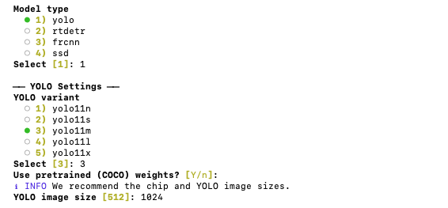
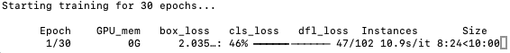

## Model Selection

Rerun ODEON. Select Workflow 4) Train OD Model. Use the same project name and *parent* directory. As in the augmentation workflow, the prepapred path (shown in yellow) should be there by default. Simply press `Enter` to proceed.

ODEON currently supports four object detection architecture, including YOLO, RT-DETR, Faster R-CNN, and Single Shot MultiBox Detector (SSD). For YOLO and RT-DETR, this is done through [Ultralytics](https://docs.ultralytics.com/) library. For Faster R-CNN, ODEON additionally supports backbone plug-ins for transfer learning.

In this lab, we will be using YOLO for its efficiency and optimization. Choose 1) yolo -\> 3) yolo11m for a relatively recent, medium-sized neural network. Use pretrained COCO weights.

For YOLO image size, select `1024` to match with the chip size.

{fig-align="center"}

## Hyperparameters

ODEON supports tuning of all hyperparameters relevant to archaeological site detection, with the possibility to add user-defined options. For simplicity in this lab, we will start with the following hyperparameters:

- `Epochs`: 30

- `Batch size`: 4

- `Learning rate`: 0.001

- `Optimizer`: AdamW

- `Early stopping patience`: 10

- `IoU threshold`: 0.5

- `Weight decay`: 0

- `Dropout`: 0

- `Dataloader workers`: 0/4 (either is fine — Ultralytics will select depending on your device)

- `Warm-start`: Skip (by pressing `Enter`)

## Training

By selecting `y`, ODEON will now start training a YOLO model. It will first download the model weights from Ultralytics.

::: callout-important
## Question

Examine the Terminal/Powershell output and locate the summary for YOLO-11m. How many layers are there? How many parameters?
:::

The training is now starting. Depending on your device, this might take a while. Training on a GPU ([cuda](https://developer.nvidia.com/cuda/toolkit)), which ODEON supports, will be very fast. Training on a CPU, however, will take a painfully long time.

{fig-align="center"}

::: callout-note
Depending on your machine, training for 30 epochs may take a few minutes to a few hours. Make sure to reserve some time for this process before the assignment deadline.
:::

As you train, ODEON will save the last and best model weights (`.pt` files) to your project directory -\> weights -\> project name -\> weights folder. As the training progresses, it will also save a `results.csv` file, recording model performance on the *validation* set at each epoch.

::: callout-caution
Please do not open `results.csv` while training is in progress, because doing so will prevent ODEON to write the file. You can duplicate the file and view it.
:::

When you are done, a few graphs will also be generated in the weights folder.

::: callout-important
## Question

Report the model performance on the *validation* set at epoch 30. Be sure to include precision, recall, and mAP50 scores.
:::

::: callout-important
## Question

Include the `confusion_matrix.png` from the `weights` folder in your word document. Calculate the recall, precision, and F-1 score of your model.

F-1 score is defined as:

$$F_1 = \frac{2 \cdot \text{Precision} \cdot \text{Recall}}{\text{Precision} + \text{Recall}}$$
:::

::: callout-note
The confusion matrix might look weird and contradict with the (hopefully) good metrics that you have. This is mostly because Ultralytics counts a prediction as correct if it overlaps a labeled box with IoU ≥ 0.45. In most of our cases, this is pretty difficult to achieve.
:::

Finally, have a look at the `results.png` in the `weights` folder. Pay close attention to train/box_loss, val/box_loss, metrics/precision, metrics/recall, and metrics/mAP50.

::: callout-important
## Question

Do you think this training has converged? In other words, do you think that more epochs will improve model performance? Why or why not? Given the loss curves, do you think your model suffers from [overfitting](lecture_notes_w7_new_nopythoncode.qmd#overfitting)?
:::
