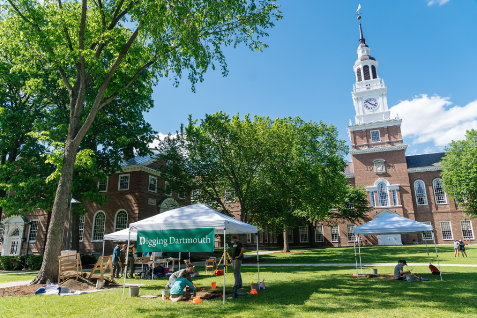
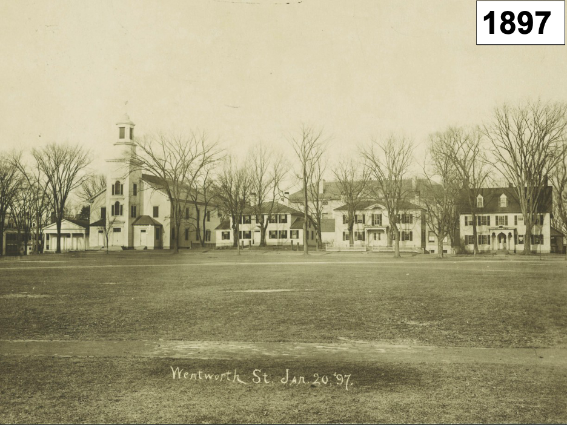
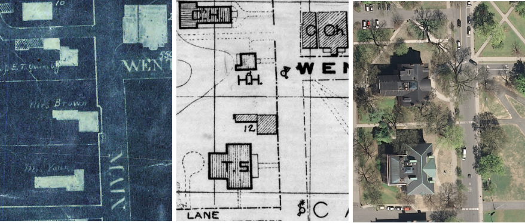
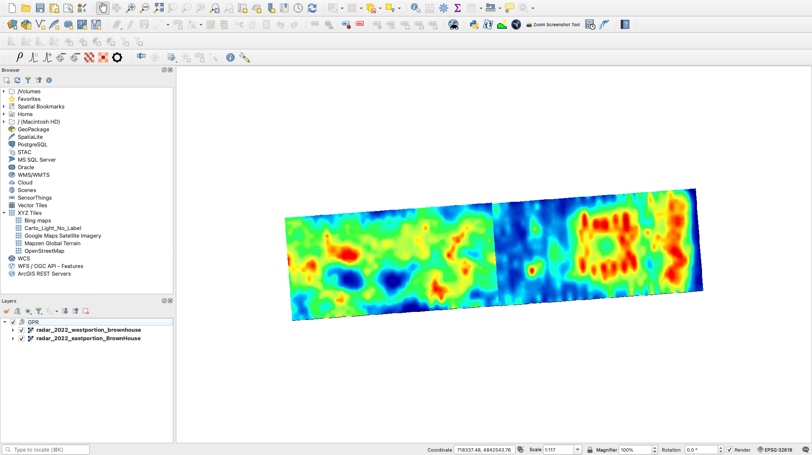
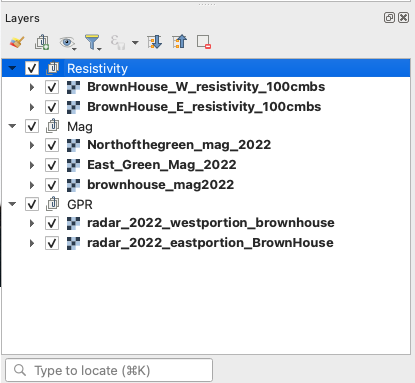
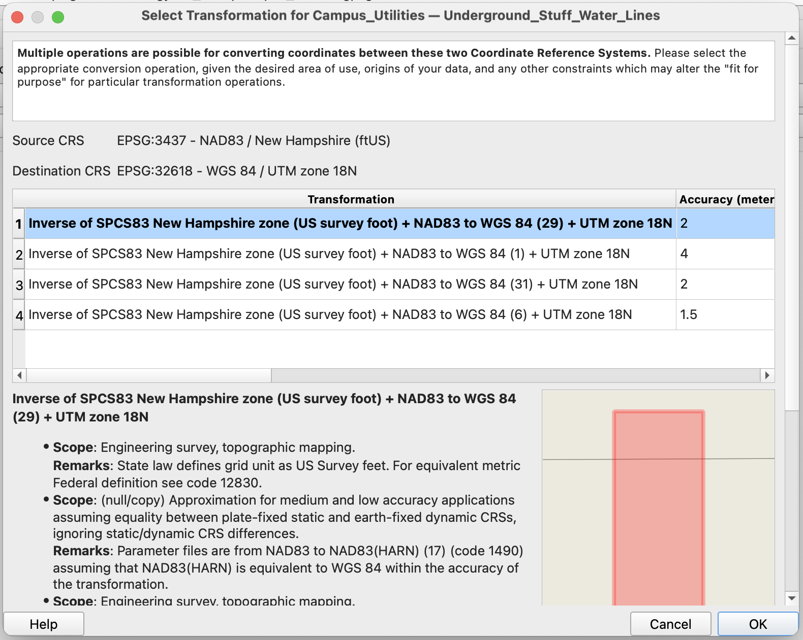
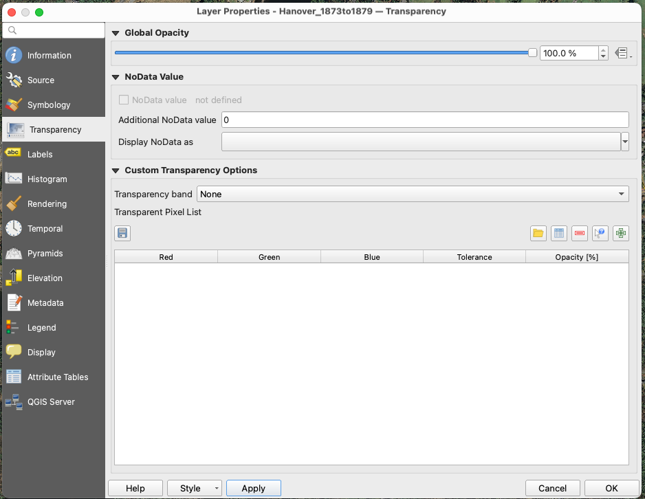
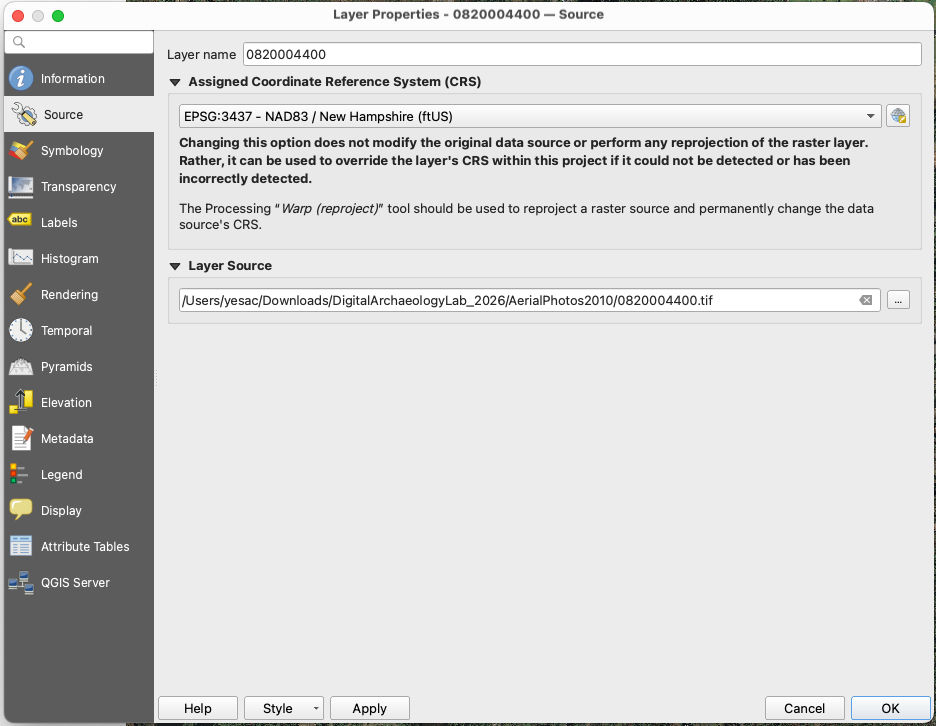
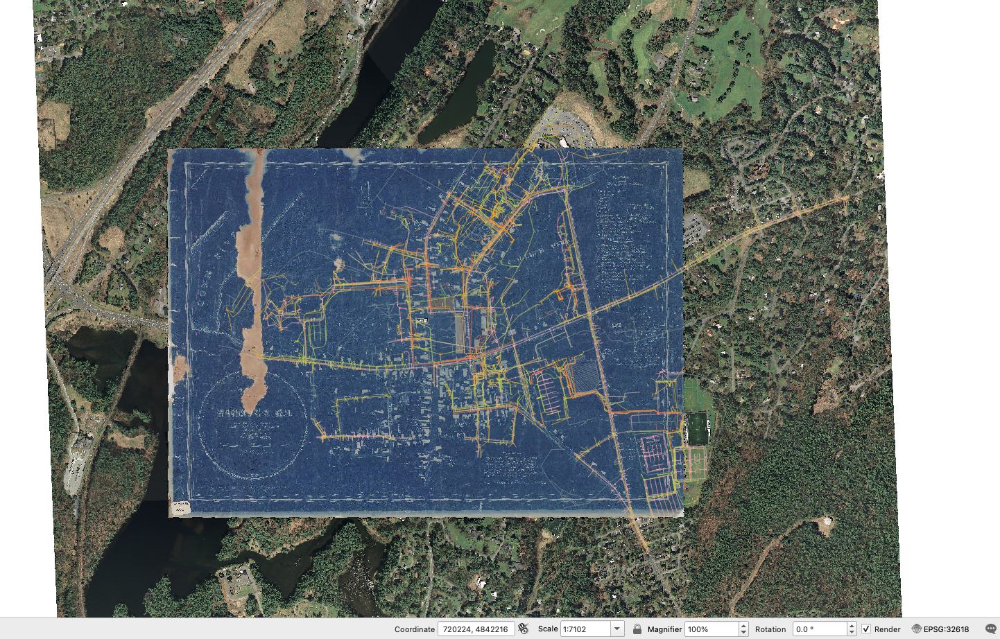

## Objectives

In this lab you will learn to interpret subsurface archaeological geophysical data collected on Dartmouth’s campus to help identify and interpret subsurface cultural remains.

Over the past few years, our research team at SPARCL has conducted geophysical surveys around campus using the same three technologies we tried out in class: ground penetrating radar (GPR), magnetic gradiometry, and electrical resistivity. These datasets, combined with analysis of historical maps and photographs, have been the basis for several archaeological excavations of 1700s house foundations in a project we call, “[Digging Dartmouth](#digging-dartmouth).”

Your analysis in this lab could help decide where to conduct a new excavation planned for Spring 2027!

{#digging-dartmouth fig-align="center" width="100%"}

## Dartmouth's Changing Landscape

Historical photographs illustrate the ways in which Dartmouth’s campus has changed over time.

[This photo from 1897](#1897) was taken from the center of the Dartmouth Green looking north to what is now Baker Lawn. Long before Baker Library was constructed, this area was home to the Dartmouth church built in 1790, a stately home originally built by Silvanus Ripley and Abigail (Wheelock) Ripley in 1786, a house built in 1793 that was occupied by Dartmouth’s long serving president Nathan Lord, and a third house built around 1800 that served as an Episcopal Church in the nineteenth century.

{#1897 fig-align="center" width="100%"}

Several of these houses were moved during early 1900s to make way for new campus construction projects, while the church burned down in 1930. However, all of the underground parts of these buildings, including basements, foundations, root cellars, privies, pits, pipes and wells, were simply covered over and left in place. These features preserve a wealth of archaeological information that reveals the lives of past Dartmouth communities.

[A series of historical maps](#historical-series) from the Rauner special collections library help to show where older buildings were once located and where subsurface remains might be preserved. The digitized maps have been georeferenced so that we can use them in a GIS. In the example below, we can see one area on the west side of the Green where the Susan Brown house was once located, now between Parkhurst and McNutt Halls.

{#historical-series fig-align="center" width="100%"}

## Datasets

In this lab you are provided with several datasets that are included in `DigitalArchaeologyLab_2025.zip`. After you've downloaded and uncompressed the `.zip` file, you should be able to see six folders/files:

{fig-align="center" width="50%"}

- `AerialPhotos2010`: high resolution aerial photographs from 2010s, orthorectified for use in GIS

- `Campus_Utilities.gpkg`: vector shapefile containing all known underground infrastructure on campus, including water pipes, sewer lines, electrical utilities, and other features

- `GPR`: GPR “time slices” of various depths for areas on Baker Lawn and Parkhurst lawn (note these datasets are labeled according to their approximate depth)

- `Historical_Maps`: Dartmouth’s campus from 1775 and 1873/9, georeferenced for use in QGIS

- `Magnetics`: processed magnetic gradiometry data for Baker Lawn, the eastern Green, and Parkhurst Hall lawn

- `Resistivity`: processed electrical resistivity survey data from Parkhurst lawn collected both at 1m and 25cm; processed 25cm resistivity data we collected on part of Baker lawn

## Importing Data

In a new project in QGIS, first import as raster layers `radar_2022_eastportion_BrownHouse.tif` and `radar_2022_westportion_brownhouse.tif` from the `GPR` folder. In the `Layers` panel, group them as `GPR`.

{fig-align="center" width="100%"}

::: callout-note
The project CRS, as shown in the right-bottom corner, should be automatically changed to `EPSG:32618`.
:::

Similarly, import `brownhouse_mag2022.tif`, `East_Green_Mag_2022.tif`, and `Northofthegreen_mag_2022.tif` from `Magnetics` folder. Group them as `Mag`.

Finally, import `BrownHouse_W_resistivity_100cmbs.tif` and `BrownHouse_E_resistivity_100cmbs.tif` from `Resistivity` folder and group them as `Resistivity`.

{fig-align="center" width="60%"}

Next, import `Campus_Utilities.gpkg` as vector layer. Add all features. In the pop-up window, select `OK` to transform the source CRS to UTM zone 18N. Group all vector layers as `Utilities`. Toggle on and off the group, check to see how they align with the geophysical data.

{fig-align="center" width="80%"}

For the basemap, add `Hanover_1873to1879.jpg` from `Historical_Maps` folder; drag the map to the bottom of all layers. In `Layer Property` -\> `Transparency`, set Additional NoData value to `0`. This step helps get rid of the black borders introduced by georeferencing.

{fig-align="center" width="80%"}

Add the four `.tif` files in `AerialPhotos2010` as raster layers to your project. After importing, in the `Layer Properties` of all four layers, change CRS to `EPSG:3437` (NAD83 / New Hampshire (ftUS)) for them to display correctly. Finally, group all four aerial photos.

{fig-align="center" width="80%"}

The final map should look like this, with all layers toggled on:

{fig-align="center" width="100%"}

You can zoom in to see different geophysical datasets. When you are ready, answer the five questions on the next page.
