 to create your own panels.](imgs/SPARCL.png){fig-align="center" width="80%"}

## Before the Lecture

We will be using [Google Earth Engine](console.cloud.google.com/earth-engine) (GEE) throughout this week's lecture and lab. Follow [this page](GEE.qmd) to create a Cloud project.

Google Earth Engine, not to be confused with [Google Earth](https://earth.google.com/web), features a multi-petabyte ($10^{15}$ bytes) catalog of multisensor satelite imagery that allows cloud-based planetary-scale analysis.

Once everything is set up, you should be able to access the code editor that looks like this:

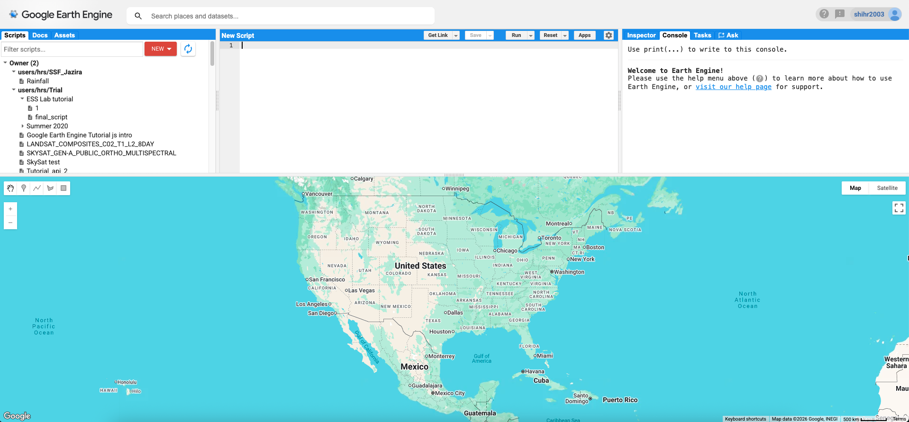{fig-align="center" width="100%"}

::: callout-note
## Quota and access

The Community Tier now gives 150 EECU-hours per month for free. While GEE used to require approval for access, registration is now instant.
:::

## Electromagnetic (EM) Spectrum

We see things because visible light reflects off objects and enter our eyes.

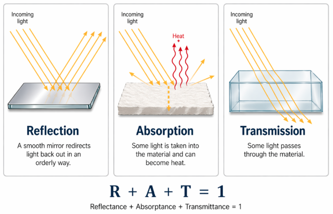{fig-align="center" width="80%"}

However, we can only see things of certain wavelengths (visible; or blue, green, red; *ca*. 0.4-0.7 micrometer or µm). What can a satellite see?

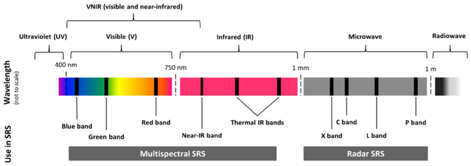{fig-align="center" width="80%"}

](images/clipboard-963398427.png){fig-align="center" width="100%"}

### EM Energy as Wave and Particle

Electromagnetic (EM) energy travels as a wave, but it is absorbed and detected as discrete packs of energy (photons).

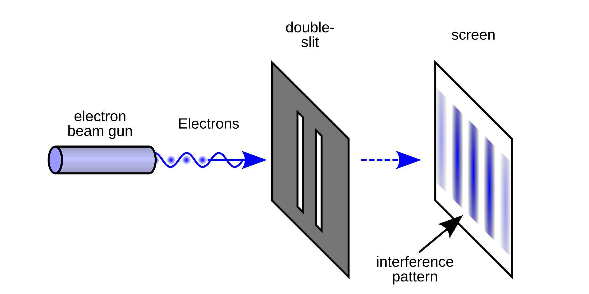{fig-align="center" width="80%"}

$$
c = \lambda\,\nu \qquad\qquad E = h\,\nu = \frac{h\,c}{\lambda}
$$

- $\lambda$ is wavelength and $\nu$ is frequency; speed of light $c = 3.00\times10^{8}\ \mathrm{m\,s^{-1}}$ and the Planck constant $h = 6.63\times10^{-34}\ \mathrm{J\,s}$. A longer wavelength means less energy per photon.
- Wien's law, $\lambda_{max} \approx 2898\ \mu\mathrm{m\,K}\,/\,T$. The Sun (≈ 5,800 K) peaks near 0.5 µm and Earth's surface (≈ 300 K) near 10 µm. Below \~3 µm (visible, NIR, SWIR), sensors record reflected sunlight; at 3–14 µm (TIR) they record emitted heat from the Earth.

### Notable Spectral Windows

| Region | Wavelength | What is recorded |
|------------------------|------------------------|------------------------|
| Visible (blue, green, red) | 0.4–0.7 µm | reflected sunlight; what the eye sees |
| Near-infrared (NIR) | 0.7–1.3 µm | reflected sunlight; vegetation |
| Shortwave infrared (SWIR) | 1.3–3 µm | reflected sunlight; water and mineral absorption |
| Thermal infrared (TIR) | 8–14 µm | heat emitted by the surface |
| Microwave | \~1 mm–1 m | radar echoes (active sensors) |

### Passive and Active Sensors

- **Passive** sensors (most satellite sensors) record what the Sun provides (either reflected or emitted as heat).

- **Active** sensors (such as synthetic aperture radar, SAR) send their own microwave pulse and measure the echo. SAR works day and night and can penetrate most clouds.

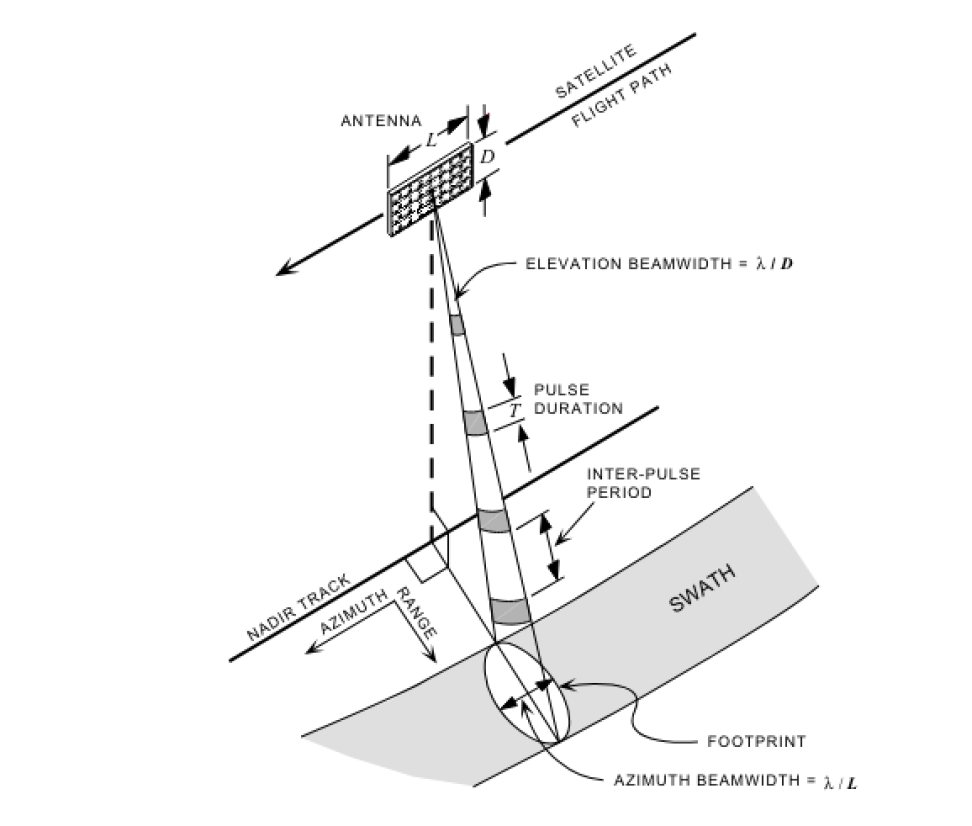{width="80%"}

### Spectral Signatures

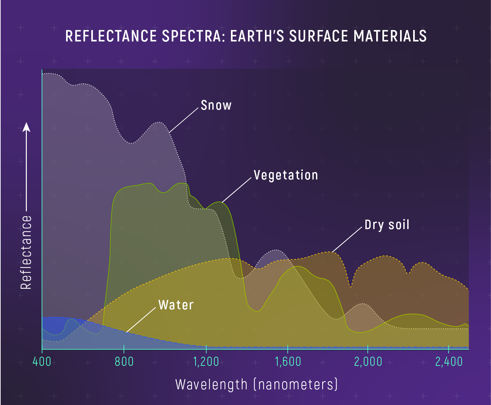{fig-align="center" width="80%"}

- Vegetation: chlorophyll absorbs blue and red; leaf water absorbs SWIR.

- Dry soil: Clay mineral absorbs near 2 micrometer.

- Water: absorbs nearly everything beyond \~ green. What color in NIR and SWIR?

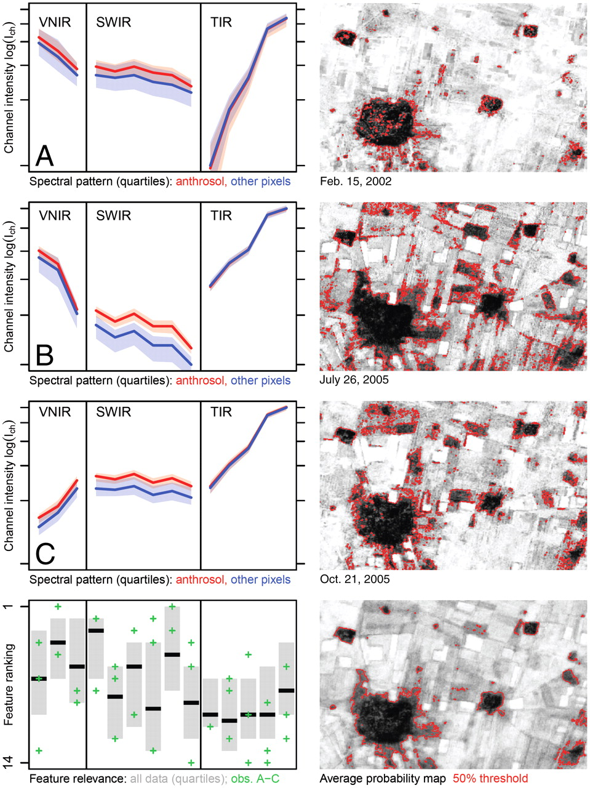{fig-align="center" width="80%"}

::: callout-important
## Question

Which part of the spectrum best separates wet soil from dry soil?
:::

::: callout-important
## Question

You are designing an Earth-observation sensor to record surface reflectance in a blue band and a SWIR band. Given the spectrum and the equations above, what spatial resolution would you reasonably expect?
:::

## A Sensor Menu

### Resolutions

Four types of resolutions are discussed; the design of sensors is usually a trade-off among them.

| Resolution | Definition | Examples |
|------------------------|------------------------|------------------------|
| Spatial | The smallest unit a sensor can distinguish | CORONA ≈ 1-3 m; Landsat 30 m; MODIS 250 m–1 km |
| Spectral | Ability to distinguish features in the EM spectrum | Landsat 9: 11 bands; MODIS: 36 bands |
| Temporal | The amount of time needed to revisit the same location | MODIS: daily; Landsat 8 + 9: 8 days |
| Radiometric | The amount of information in each pixel (*i.e.* bit depth) | 8-bit = 256 levels (TM); 14-bit = 16,384 levels (Landsat 9) |

@howey2026 suggest that coarser spatial resolution (but higher temporal resolution) requires "more inferential work. Do you agree?

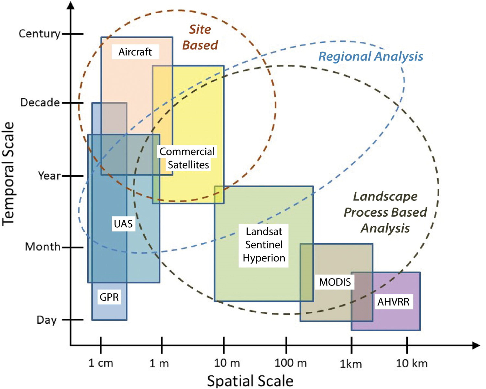{fig-align="center" width="80%"}

### Notable Sensors

| Sensor (platform) | Years | Pixel size | Bands | Revisit | Access |
|------------|------------|------------|------------|------------|------------|
| TM (Landsat 4–5) | 1982–2011 | 30 m (TIR 120 m) | 7: VIS–SWIR, TIR | 16 days | free |
| ETM+ (Landsat 7) | 1999–2024 | 30 m; pan 15 m; TIR 60 m | 8 | 16 days | free |
| OLI/TIRS (Landsat 8, 9) | 2013–; 2021– | 30 m; pan 15 m; TIR 100 m | 11 | 8 days combined | free |
| MSI (Sentinel-2) | 2015– | 10/20/60 m | 13 | 5 days | free |
| SAR (Sentinel-1) | 2014– | ≈ 10 m | radar | 6–12 days | free |
| ASTER (Terra) | 2000– | 15 m VNIR; 30 m SWIR; 90 m TIR | 14 | 16 days or upon request | free; SWIR dead since 2008 |
| MODIS (Terra, Aqua) | 2000– | 250 m–1 km | 36 | 1–2 days | free |
| PlanetScope (CubeSats) | \~2016– | ≈ 3 m | 4–8 | \~daily | commercial; archive access |

::: callout-important
## Question

How do the CORONA satellite panoramic camera systems compare to Landsat 8/9's OLI?
:::

### Landsat: A Closer Look

- TM (Landsat 4–5), ETM+ (7), OLI + TIRS (8), and OLI-2 + TIRS-2 (9). Landsat 9 records 14-bit data.

- Radiometric correction and atmospheric correction.

- Processing levels **([Collection 2](https://www.usgs.gov/landsat-missions/landsat-collection-2))**:

  - Level-1 is calibrated and terrain-corrected, and can be converted to top-of-atmosphere (TOA) reflectance.
  - **Level-2** is corrected for the atmosphere and provides surface reflectance (SR) plus surface temperature (ST).
  - Level-3 is the further derivatives of Level-2 products (archaeologists rarely use them).

- Clouds: each scene carries a precomputed `CLOUD_COVER` percentage. Level-2 adds a per-pixel quality band (`QA_PIXEL`, 16-bit masks; USGS provides [documentation](https://www.usgs.gov/landsat-missions/landsat-collection-2-quality-assessment-bands)).

- Band numbers: they do not match between generations. Note [surface temperature](https://www.usgs.gov/landsat-missions/landsat-collection-2-surface-temperature) conversion to Level 2 products.

|                          | Blue | Green | Red | NIR | SWIR1 | SWIR2 | Thermal |
|--------------------------|------|-------|-----|-----|-------|-------|---------|
| TM / ETM+ (Landsat 5–7)  | 1    | 2     | 3   | 4   | 5     | 7     | 6       |
| OLI / TIRS (Landsat 8–9) | 2    | 3     | 4   | 5   | 6     | 7     | 10, 11  |

- Integration of Landsat 5/7 NIR with Landsat 8/9 bands needs prudence. Band 8 can be used for pan-sharpening.

{fig-align="center" width="100%"}

- [Whisk Broom and Push Broom sensors](https://svs.gsfc.nasa.gov/12754/):

| Design | How it works | Examples |
|------------------------|------------------------|------------------------|
| Whiskbroom | a moving mirror sweeps a few detectors across the track | TM, ETM+ |
| Pushbroom | a linear array of detectors images a whole row at once | OLI, TIRS, Sentinel-2 MSI, ASTER VNIR/SWIR |
| Film camera | records a whole area at once on film or a 2-D array | CORONA (film) |

### Demo: Getting Landsat Data in GEE

In this section, we will try to load decades of satellite imagery for the archaeological landscape around Tell Beydar that we saw in Lab 1. First, we will need to define the study area. Copy and paste the following code to GEE.

``` javascript
// Step 1. Study area
var beydar = ee.Geometry.Point([40.587, 36.738]);
var aoi = ee.Geometry.Rectangle([40.50, 36.66, 40.68, 36.81]);

Map.setOptions('SATELLITE'); // basemap
Map.centerObject(beydar, 14); // 14 is the scale
Map.addLayer(aoi, {color: 'yellow'}, 'Study area', true, 0.2);
Map.addLayer(beydar, {color: 'red'}, 'Tell Beydar');
```

Next, load Landsat 8 & 9, collection 2, level 2 data and filter it using the AoI.

``` javascript
// Step 2. Load and filter
var l89 = ee.ImageCollection('LANDSAT/LC08/C02/T1_L2')
    .merge(ee.ImageCollection('LANDSAT/LC09/C02/T1_L2'));

var l89Here = l89.filterBounds(aoi);
print('Landsat 8/9 scenes over Tell Beydar:', l89Here.size());
```

Now, let us get the vegetation-rich, clear images from 2024. How many scenes does each filter remove?

``` javascript
var l89Plant = l89Here.filterDate('2024-03-01', '2024-07-01');
print('...from March-June 2024:', l89Plant.size());

var l89Clear = l89Plant.filter(ee.Filter.lt('CLOUD_COVER', 10));
print('...with less than 10% cloud:', l89Clear.size());

print(l89Clear);
```

A median composite will drop out clouds and shadows, because for every pixel it will take the median value of all clear scenes. Run the following code:

``` javascript
// Level-2 SR: bands SR_B1...SR_B7 are stored as integers.
// Multiply by 0.0000275 and subtract 0.2 to get reflectance (0-1).
var spring = l89Clear.median()
  .select('SR_B.') // SR_B1 ... SR_B7
  .multiply(0.0000275)
  .add(-0.2);

Map.addLayer(spring, {bands: ['SR_B4', 'SR_B3', 'SR_B2'], min: 0, max: 0.5}, 'Level-2 SR, 4-3-2');

// Level-2 also holds surface temperature (band 10): scale to kelvin, then to °C

var lst = l89Clear.median().select('ST_B10')
  .multiply(0.00341802).add(149.0)
  .subtract(273.15);

Map.addLayer(lst, {min: 25, max: 55, palette: ['blue', 'yellow', 'red']},
  'Surface temperature (°C)', false);
```

You can compare Level-2 products with Level-1 TOA. What are the differences and why? What color is most removed?

``` javascript
// Level-1 TOA

var toa = ee.ImageCollection('LANDSAT/LC09/C02/T1_TOA')
  .filterBounds(aoi)
  .filterDate('2024-03-01', '2024-07-01')
  .filter(ee.Filter.lt('CLOUD_COVER', 10))
  .median();
  
Map.addLayer(toa, {bands: ['B4', 'B3', 'B2'], min: 0, max: 0.5}, 'Level-1 TOA, 4-3-2', false);
```

## Band Composites

A raster can be visualized using three color channels, and a composite assigns any three bands to the display of red, green, and blue. By assigning different bands to these three channels, one can visualize the EM spectrum beyond visible.

| Composite | Landsat 8/9 (R-G-B) | What stands out |
|------------------------|------------------------|------------------------|
| Natural color | 4-3-2 | what the eye *expects* |
| Color infrared | 5-4-3 | healthy vegetation in red; crop marks |
| Agriculture | 6-5-2 | moisture and crop differences |
| SWIR soils | 7-6-4 | soil and mineral differences; bright bare ground |

Now add different composites to GEE. Which composite makes the round *Kranzhügel* and its lower town stand out best?

``` javascript
// Step 3. Composites (Landsat 8/9 band numbers) 

Map.addLayer(spring, {bands: ['SR_B5', 'SR_B4', 'SR_B3'], min: 0, max: 0.5},  'Color infrared, 5-4-3', false);

Map.addLayer(spring, {bands: ['SR_B6', 'SR_B5', 'SR_B2'], min: 0, max: 0.5}, 'Agriculture, 6-5-2', false);

Map.addLayer(spring, {bands: ['SR_B7', 'SR_B6', 'SR_B4'], min: 0, max: 0.5},  'SWIR soils, 7-6-4', false);
```

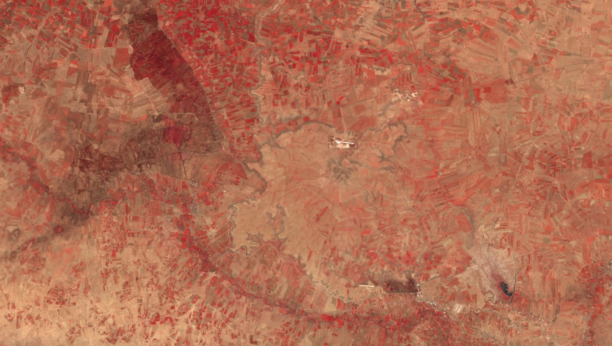{fig-align="center" width="80%"}

## Spectral Indices

Spectral indices can help us compress two bands into one and eliminate much of the illumination/slope effects. Most indices follow a "normalized difference" template, which runs from -1 to 1:

$$
\mathrm{ND} = \frac{\rho_A - \rho_B}{\rho_A + \rho_B}
$$

Here $\rho$ is *surface reflectance* (0-1; important!) in bands A and B. Some common indices are as follows:

| Index      | Formula                               | Landsat 8/9 bands |
|------------|---------------------------------------|-------------------|
| NDVI       | (NIR − Red) / (NIR + Red)             | 5, 4              |
| SAVI       | 1.5 × (NIR − Red) / (NIR + Red + 0.5) | 5, 4              |
| NDMI       | (NIR − SWIR1) / (NIR + SWIR1)         | 5, 6              |
| Clay ratio | SWIR1 / SWIR2                         | 6, 7              |
| NDWI       | (Green − NIR) / (Green + NIR)         | 3, 5              |

Luckily, GEE provides a [function](https://developers.google.com/earth-engine/apidocs/ee-image-normalizeddifference) to calculate the normalized difference easily. Add the following code to your GEE code editor. Do you notice anything interesting?

``` javascript
// Step 4. Indices from the spring composite

var ndvi = spring.normalizedDifference(['SR_B5', 'SR_B4']).rename('NDVI');
var ndwi = spring.normalizedDifference(['SR_B3', 'SR_B5']).rename('NDWI');
var savi = spring.expression('1.5 * (NIR - RED) / (NIR + RED + 0.5)', {
  NIR: spring.select('SR_B5'),
  RED: spring.select('SR_B4')
}).rename('SAVI');

Map.addLayer(ndvi, {min: 0, max: 0.5, palette: ['brown', 'yellow', 'green']}, 'NDVI', false);
Map.addLayer(savi, {min: 0, max: 0.5, palette: ['brown', 'yellow', 'green']}, 'SAVI', false);
Map.addLayer(ndwi, {min: 0, max: 0.5, palette: ['white', 'blue']}, 'NDWI', false);
```

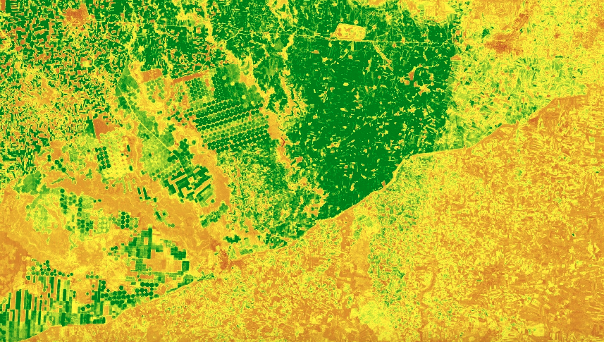{fig-align="center" width="80%"}

### Timing

@menze2012 classified 160 ASTER scenes from 2003–2007, where they averaged the probability maps to prevent seasonal variation. Can you further create an `ee.ImageCollection` named `dryScenes` from `l89Here` with `filterDate('2024-08-01', '2024-11-01')`, and compute its NDVI map? How does summer NDVI compare with the spring one?

## Land Use and Land Cover (LULC) Classification

@bauer2018 suggests that Iron Age and Early Historic Period residents in Maski, Northern Karnataka, used more water-retentive, clay-rich, blacker *regur* soils for agriculture, and observed greater social inequalities in later periods.

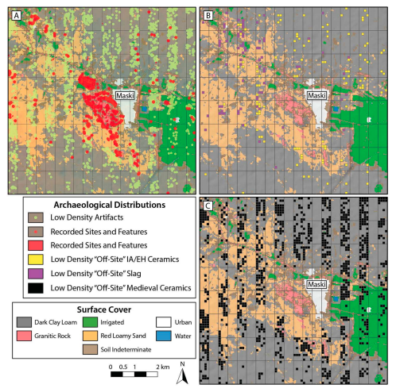{fig-align="center" width="80%"}

This work relies on Land Cover classification using multispectral data, which we can use GEE to generate today. There are usually two methods for LC classification.

### Unsupervised Methods: k-means

Unsupervised methods (*e.g.* k-means) find clusters of similar pixels, and you will name the clusters afterwards. Try the following code in GEE. Are similar features correctly clustered?

``` javascript
// Step 5a. Unsupervised: k-means 

var features = spring.select(['SR_B2', 'SR_B3', 'SR_B4', 'SR_B5', 'SR_B6', 'SR_B7'])

// Learn the clusters from 5,000 random pixels
var pixels = features.sample({region: aoi, scale: 30, numPixels: 5000, seed: 1});

var kmeans = ee.Clusterer.wekaKMeans(6).train(pixels);
var clusters = features.cluster(kmeans);
Map.addLayer(clusters.randomVisualizer(), {}, 'k-means, 6 clusters');
```

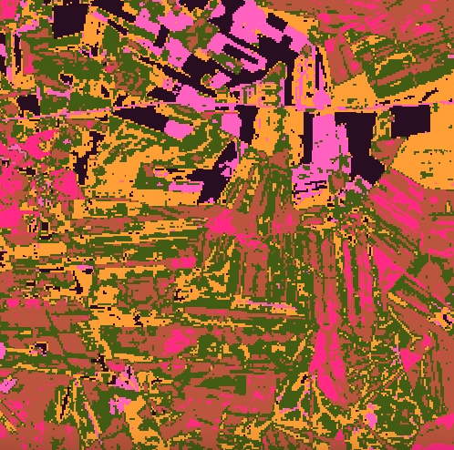{fig-align="center" width="80%"}

### Supervised Methods: Random Forest with Three Classes

Supervised methods (maximum likelihood, random forest, support vector machines, deep learning) start from training examples that you provide.

In GEE, turn off all layers except for the basemap. Hover over `Geometry Imports` (top left of the map view) and click `+ new layer`. If there is no `Geometry Imports` option, select `Add a marker` {width="5%"}.

Click the gear icon next to the new layer. Name it `developed`, set **`Import as`** to **`FeatureCollection`**, click **`+ Property`**, and add `class` = `0` like [below](#add-points-GEE). Choose red for this class.

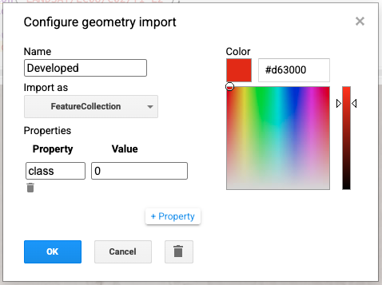{#add-points-GEE fig-align="center" width="80%"}

With `developed` selected, use the point tool to select at least 30 pixels that represent "developed" land cover, such as roads, houses, ancient buildings, etc. You should try to include as many varieties and be as precise as possible. Avoid sampling [mixed pixels](#mixed-pxs)!

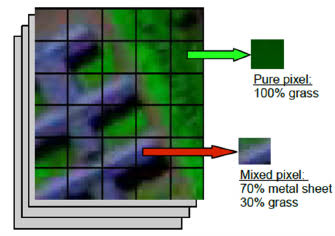{#mixed-pxs fig-align="center" width="80%"}

Repeat for `vegetation` (`class` = `1`: fields that are green in spring, trees, etc.) and `bare` (`class` = `2`: bare soil, rocks, etc.).

After you are done, run the following code:

``` javascript
// Step 5b. Supervised: random forest 
var trainingPoints = developed.merge(vegetation).merge(bare);
var training = features.sampleRegions({
  collection: trainingPoints,
  properties: ['class'],
  scale: 30
});
print('Training pixels per class:', training.aggregate_histogram('class'));

var rf = ee.Classifier.smileRandomForest(100).train({
  features: training,
  classProperty: 'class',
  inputProperties: features.bandNames()
});

var classified = features.classify(rf);
Map.addLayer(classified, {min: 0, max: 2, palette: ['red', 'green', 'yellow']},
  'Random forest: developed / crop / bare');
```

Compare results between two classification methods; how is Tell Beydar classified?

### Confusion Matrix

To evaluate the accuracy of his classification, @bauer2018 used a confusion matrix:

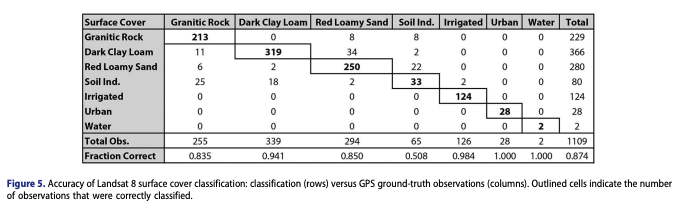{fig-align="center" width="100%"}

This helps evaluate his classification. Four common metrics are given here, where TP, TN, FP, and FN denote true positive, true negative, false positive, and false negative.

$$
Accuracy = \frac{TP+TN}{TP+TN+FP+FN}
$$
$$
Precision = \frac{TP}{TP+FP}
$$
$$
Recall = \frac{TP}{TP+FN}
$$
$$
F1 = \frac{2*Precision*Recall}{Precision+Recall} = \frac{2*TP}{2*TP+FP+FN}
$$

Note that precision is also called user's accuracy or consumer's accuracy, whereas recall is also known as producer's accuracy or sensitivity.

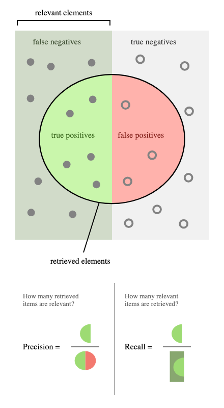{fig-align="center" width="80%"}

::: callout-important
## Question

@menze2012 mention that settlement signals covered about 4% of their search area. Which metrics are best for evaluating their archaeological detection?
:::

Now let us check the metrics for your supervised classification.

``` javascript
// Step 6: sample the map where the drawn points are
var check = classified.sampleRegions({
  collection: trainingPoints,     // the drawn points, not 'training'
  properties: ['class'],
  scale: 30,
  geometries: true
});
print('Your label (class) vs map (classification): 0 developed, 1 vegetation, 2 bare', check);
```

## Change Detection {#change-detection}

For Landsat, we can compare how different indices or LULC have changed over the same season of different years. We can also subtract an index at date 1 from the same index at date 2. For a true time series, where computations are applied to every pixels, try the following code using [MODIS](https://developers.google.com/earth-engine/datasets/catalog/MODIS_061_MCD12Q1) data over the past 26 years.

``` javascript
// Step 7: Change detection using MODIS
var modis = ee.ImageCollection('MODIS/061/MOD13Q1')
  .filterDate('2000-01-01', '2026-01-01')
  .select('NDVI');
print(ui.Chart.image.series({
  imageCollection: modis,
  region: aoi,
  reducer: ee.Reducer.mean(),
  scale: 250
}).setOptions({title: 'Mean NDVI around Tell Beydar'}));
```

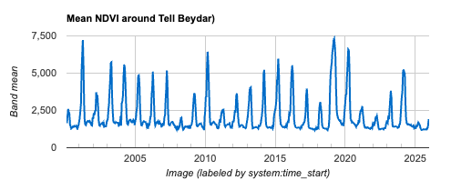{fig-align="center" width="90%"}
