## Machine Learning (ML) Basics

In machine learning we supply examples and the computer estimates the rules.

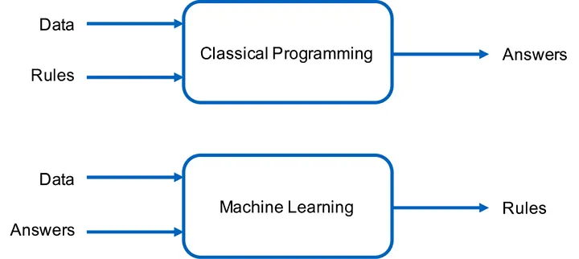{fig-align="center" width="60%"}

To do this, three ingredients are required:

1.  A **model** with adjustable parameters: *e.g.*, for a regression model, $\hat{y} = wx + b$
2.  A **loss** that measures error: *e.g.*, mean squared error (MSE), $L = \frac{1}{n}\sum_{i=1}^{n}(\hat{y}_i - y_i)^2$
3.  An **optimizer** that lowers the loss: *e.g.*, $w \leftarrow w - \eta \frac{\partial L}{\partial w}$, where $\eta$ is the learning rate, the size of each downhill step.

### Linear Regression

For example, in [linear regression](https://developers.google.com/machine-learning/crash-course/linear-regression/loss), this means finding the weight $w$ and bias $b$ in the model that minimizes the loss.

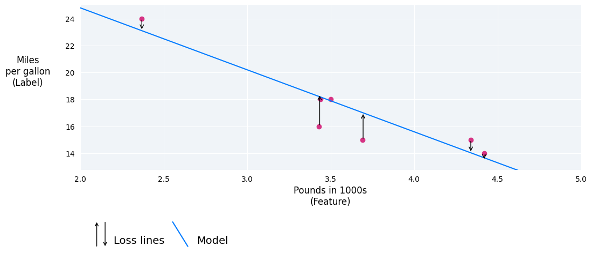{fig-align="center" width="100%"}

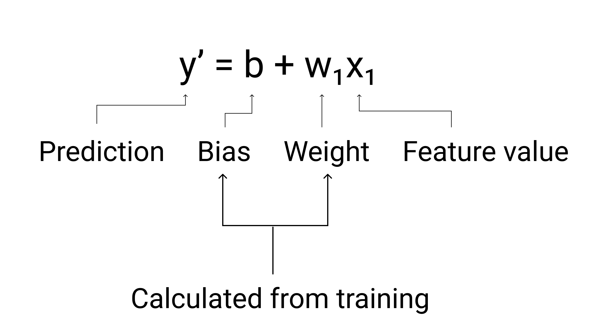{fig-align="center" width="60%"}

::: {.callout-important collapse="true"}
## Question

We want to predict the the year that a [Roman *denarius*](https://en.wikipedia.org/wiki/Denarius) was produced based on its silver content only, and we have the following (simplified) *training* dataset:

| Coin silver in grams (feature; $x$) | Year produced, CE (label; $y$) |
|-------------------------------------|--------------------------------|
| 3.5                                 | 180                            |
| 3.69                                | 150                            |
| 3.44                                | 170                            |
| 3.43                                | 160                            |
| 3.80                                | 150                            |

A computer gives a model that reads: $\hat{y} = 0.5x + 160$. Using a calculator, estimate the mean squared error (MSE).
:::

### Gradient Descent

To minimize loss, we ask the computer to iteratively find the combination of weight and bias that lowers the loss. To do so, we calculate the slope of the tangent to the loss function at each weight and bias.

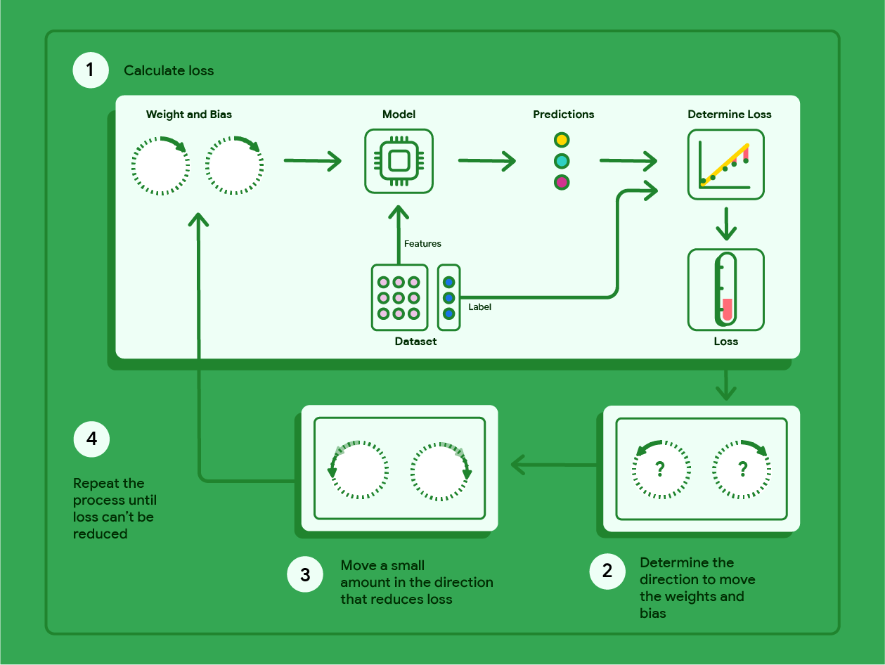{fig-align="center" width="100%"}

Then, we move a small amount ($\eta * slope$) to calculate the next weight and bias. We usually arbitrary define the learning rate ($\eta$) as, say, 0.1. The model can be updated using the following methods:

$$
\small{New\ weight = old\ weight - (small\ amount * weight\ slope)}
$$ $$
\small{New\ bias = old\ bias - (small\ amount * bias\ slope)}
$$

::: {.callout-important collapse="true"}
## Question

For our previous (terribly inaccurate) model, $\hat{y} = 0.3x + 16$, the slopes for the lines tangent to the weight and bias are calculated as follows:

$weight\ slope = 10$

$bias\ slope = 10$

After updating the model, calculate the current loss.
:::

We plot how loss changes after each of these updates and determine if the model has converged.

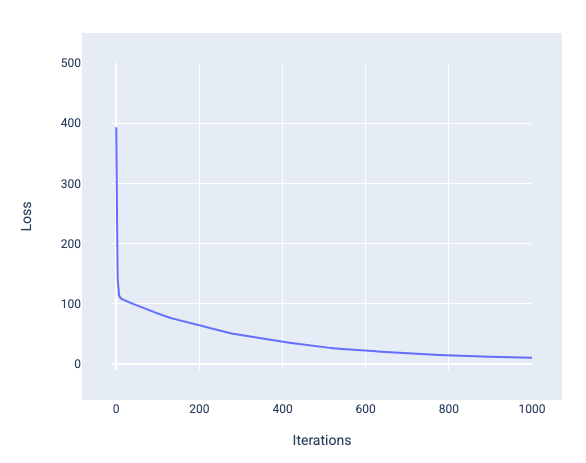{fig-align="center" width="80%"}

Plotted in a 3-D convex surface with weight and bias, the loss function changes as follows:

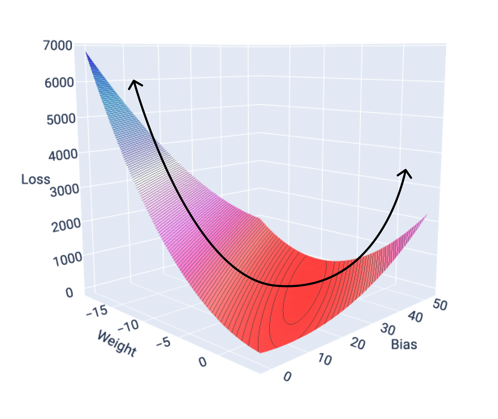{fig-align="center" width="100%"}

Learning rate (small steps at which the parameter updates) influences how quickly the model converges. If the learning rate is low, the model can take a long time to converge. If the learning rate is too high, parameters may overshoot the minimum.

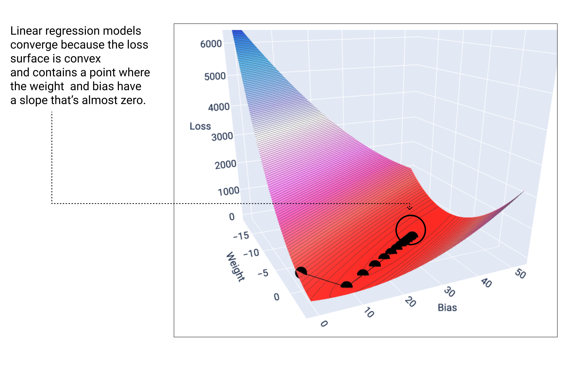{fig-align="center" width="100%"}

We want to reach the global minimal combo of weight and bias.

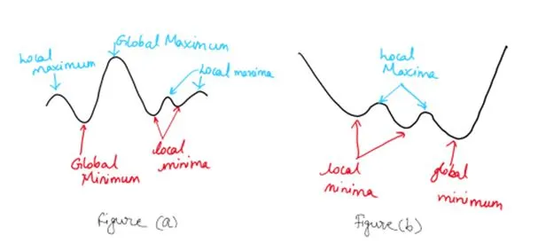{fig-align="center" width="100%"}

::: {.callout-important collapse="true"}
## Question

Regarding gradient descent, which of the following statement is false?

**A.** The minimum loss for the model is typically greater than 0.

**B.** The model rarely finds the weight and bias combo that exactly minimizes loss.

**C.** Smaller learning rate is needed to not overshoot global minimum.
:::

### Hyperparameters

In contrast to parameters like weight and bias, hyperparameters denote project-wise training config. Besides learning rate, hyperparameters can also include batch size and number of epochs.

Batch size refers to the number of examples the model processes before updating its weight and bias. Smaller batch size takes longer to run and can be noisy; larger batch sizes can be quicker but computationally intensive.

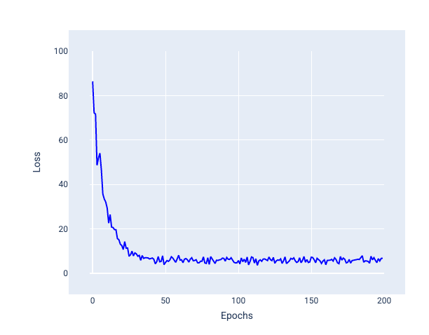{fig-align="center" width="80%"}

An epoch means that the model has processed every example in the training set. Training typically involves many epochs, and the number of epochs determine whether the model converges or not.

::: {.callout-important collapse="true"}
## Question

Our complete training dataset of Roman *denarii* has 5,000 examples. If we have a batch size of 4, and the training would take 10 epochs to converge, how many iterations (or batches) do we need to run?
:::

### Logistical Regression

Linear regression and logistical regression are two of the simplest ML models. While linear regression calculates the linear relationship between two variables, logistical regression predicts probability by applying a sigmoid function to $wx + b$.

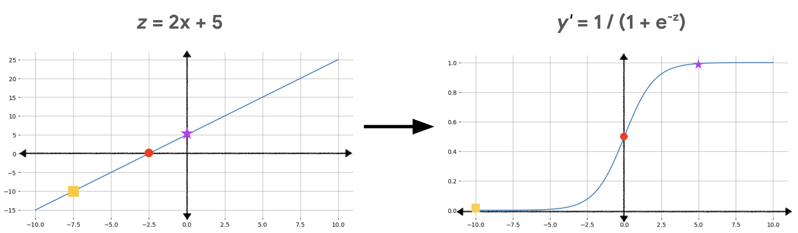{fig-align="center" width="100%"}

For the sigmoid function, we use log loss to calculate the loss because when $y'$ is closer to 0 and 1, changes in $z$ leads to very small changes in $y'$.

For classification, we set a threshold to determine a positive prediction (`1`). For example, if we set a threshold of 0.75 for a classifier to classify a coin to be a denarius of Hadrian, any predicted probability greater than 0.75 will return `1`.

{fig-align="center" width="30%"}

::: {.callout-important collapse="true"}
## Question

Which of the following archaeological applications can be solved with logistical regression?

**A**. Using a denarius's density, predict its silver percentage.

**B**. Using distance to water, predict site presence.

**C**. Using the mean diameter of clay pipe stems found in a deposit, predict the date of the deposit.
:::

For multi-class classification, we train multiple binary classifiers.

::: {.callout-important collapse="true"}
## Question

If we were to train a multi-class classifier that categorizes denarii of Nerva, Trajan, Hadrian, Antoninus Pius, and Marcus Aurelius based on logistical regression of silver content, how many binary classifiers would we need at least?
:::

### Confusion Matrix

Four common metrics are used to determine performance of simple models, where TP, TN, FP, and FN denote true positive, true negative, false positive, and false negative.

$$
Accuracy = \frac{TP+TN}{TP+TN+FP+FN}
$$ $$
Precision = \frac{TP}{TP+FP}
$$ $$
Recall = \frac{TP}{TP+FN}
$$ $$
F1 = \frac{2*Precision*Recall}{Precision+Recall} = \frac{2*TP}{2*TP+FP+FN}
$$

Note that precision is also called user's accuracy or consumer's accuracy, whereas recall is also known as producer's accuracy or sensitivity.

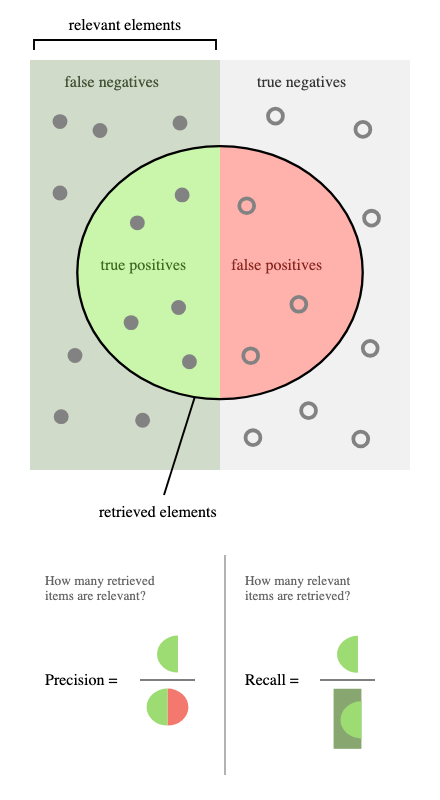{fig-align="center" width="80%"}

::: {.callout-important collapse="true"}
## Question

A classifier is tested on 146 cut marks and 13 crocodile tooth marks. It predicts cut mark for all 159. What are its accuracy and its crocodile recall?

**A**. 100% and 8%

**B**. 92% and 0%

**C**. 92% and 8%

**D**. 50% and 50%
:::

@trier2018 report a best validation accuracy of 99.46% for roundhouses. Their tables list 26 roundhouses and 1,842 background patches for validation. On Machrie Moor, the model made 11 correct and 13 false roundhouse identifications against 15 known roundhouses. Those 15 were the training examples.

::: {.callout-important collapse="true"}
## Question

Using the Machrie Moor counts above, what are the precision and recall?

**A**. Precision \<1%, recall 87%

**B**. Precision 46%, recall 73%

**C**. Precision 42%, recall 50%

**D**. Precision 42%, recall 87%
:::

## Neural Networks and Deep Learning

To solve complex, non-linear problems, such as segmenting a site in a satellite image, a linear function that draws a straight line is not enough.

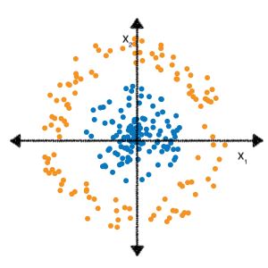{fig-align="center" width="50%"}

One way to do this is through ensemble learning, such as random forest, that combines multiple ML models together, with random sampling.

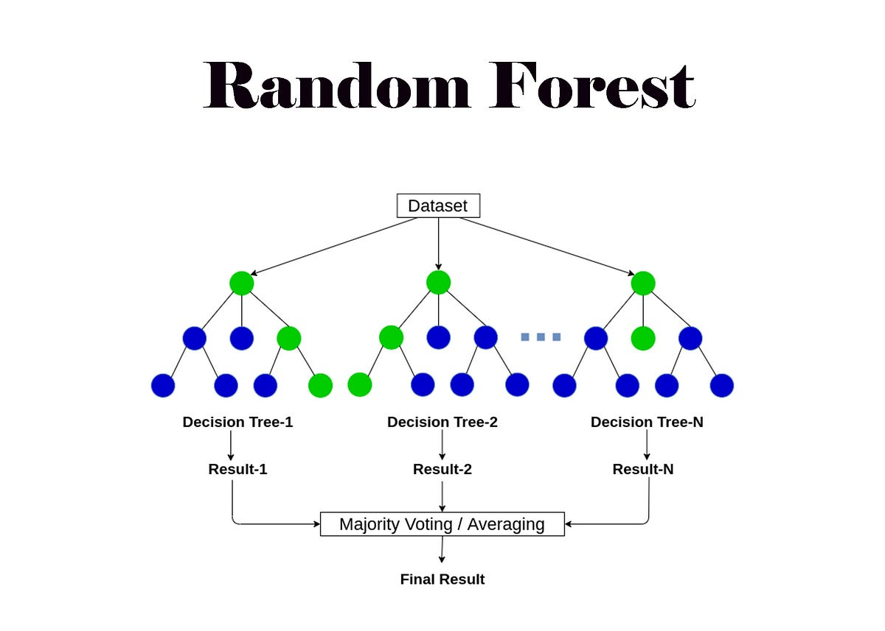{fig-align="center" width="80%"}

While RFs have gained popularity in archaeology, see *e.g.*, [@orengo2020], neural networks (NNs) are a much more popular method today. NNs model after a real neuron, where each artificial neuron contains one linear function and one non-linear activation function (such as ReLU, sigmoid).

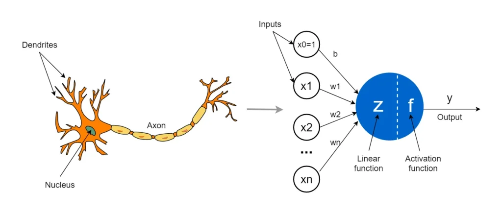{fig-align="center" width="100%"}

Stacking multiple artificial neurons together, and you get a neural network:

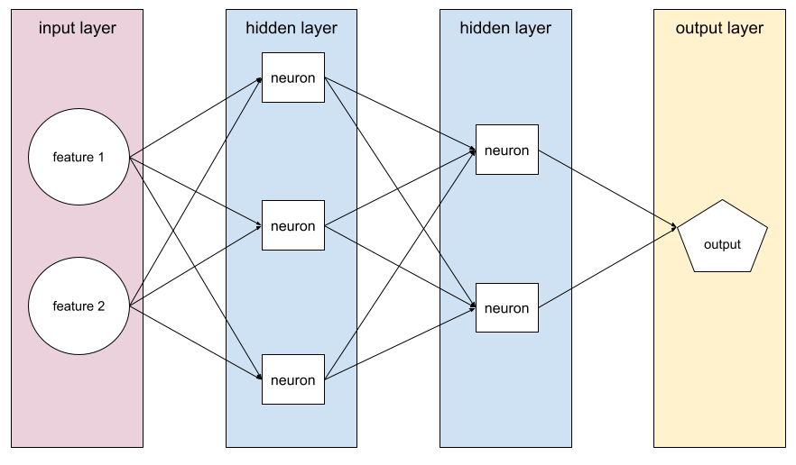{fig-align="center" width="100%"}

For each neuron in the first hidden layer, for example, it has 2 weights (one for each input value) and 1 bias.

::: {.callout-important collapse="true"}
## Question

How many parameters (weights and biases) does this neural network above have, *in total*?

**A**. 10

**B**. 20

**C**. 23

**D**. 26
:::

In NNs, gradient descent is usually done through backpropagation, which is handled automatically by mainstream ML libraries these days. Deep learning refers to the depth of the NNs.

### Convolutional Neural Networks (CNNs)

CNNs are a set of NNs that are particularly suitable to archaeological applications. Beyond fully connected neurons like above, CNNs feature convolutional layers to first extract features.

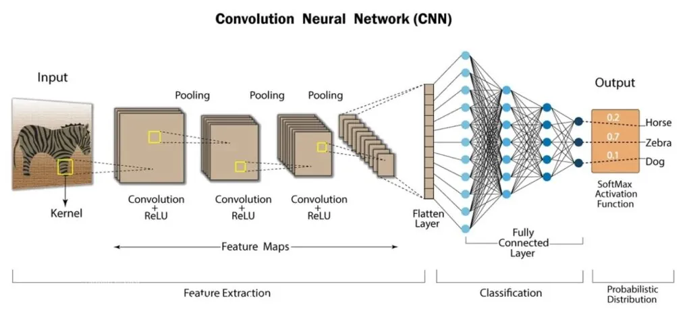{fig-align="center" width="100%"}

Feature extracting convolutional layers read through an input using a sliding window (kernel filter, hence convolutional), and apply a max-pooling filter.

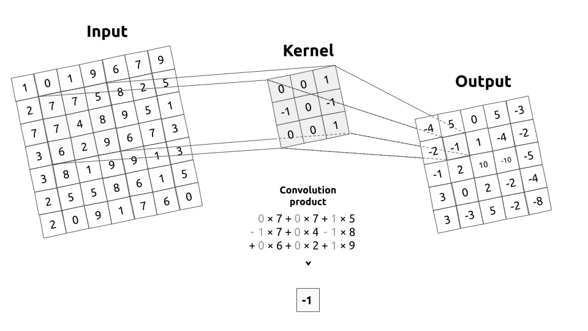{fig-align="center" width="100%"}

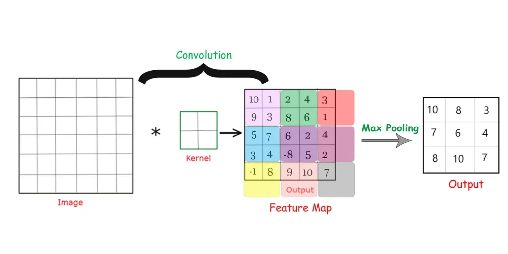{fig-align="center" width="100%"}

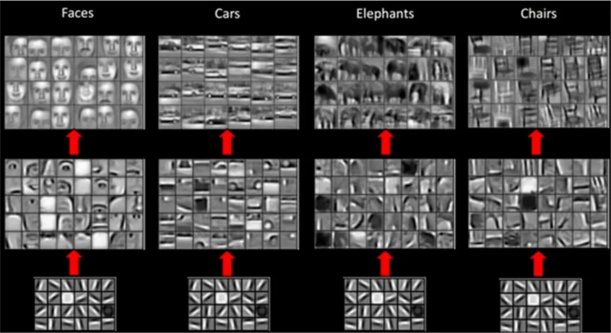{fig-align="center" width="100%"}

Particularly useful are two architectures: YOLO and Faster R-CNN.

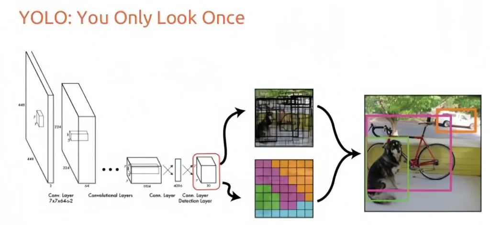{fig-align="center" width="100%"}

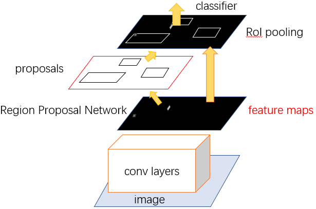{fig-align="center" width="100%"}

### Computer Vision Tasks

CNNs has become a key tool in computer vision. Computer vision typically involves three tasks:

- Image classification (*e.g.*, if an image has a Roman *denarius*)

- Object detection (*e.g.*, drawing bounding boxes around multiple sites in CORONA images)

- Segmentation (*e.g.*, performing pixel-wise search to trace shape of sites)

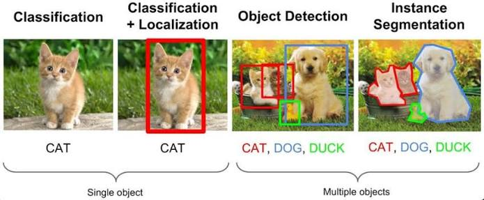{fig-align="center" width="100%"}

::: {.callout-important collapse="true"}
## Question

@mccoy2020 suggests that archaeological site is a theoretical apparatus that archaeologists apply differently. Recall the difficulty in defining the tell in Q1 in [our first lab](Lab1.qmd) and the fuzzy boundaries of a site, which method can best address this "site problem?"

**A**. Classification

**B**. Classification + localization

**C**. Object detection

**D**. Segmentation
:::

### Transfer Learning

Archaeological training sets are small, so we start from a network trained on another task, replace the final layers with archaeological features, and fine-tune the pre-trained backbone. YOLO, for example, is pretrained on the [COCO](https://cocodataset.org/#home) (Common Objects in Context) dataset.

[Explore the dataset](https://cocodataset.org/#explore) that contains over 200k annotated images; discuss the benefits of using COCO-pretrained weights in archaeology.

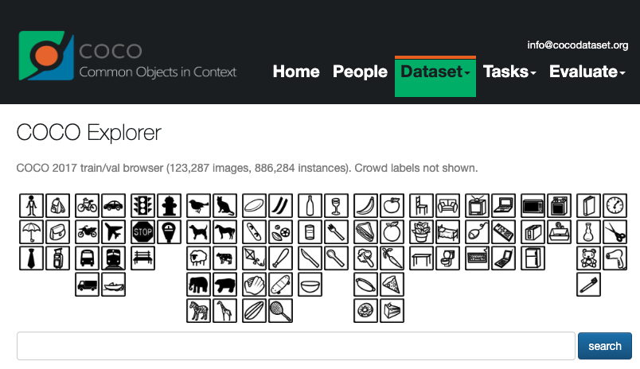{fig-align="center" width="100%"}

### Generative Models and Large Language Models (LLMs)

Current hype in AI is largely a result of LLMs. An LLM estimates the probability of a token (smaller parts of a word) occurring with a sequence. In archaeology, tools such as [Aeneas and Ithaca](https://predictingthepast.com/) that predict Latin and Greek Epigraphy build on the same transformer technology as LLMs.

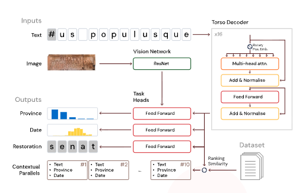{fig-align="center" width="80%"}

By experimenting with images generated by ChatGPT and DALL-E 3, @magnani2025 observed outdated depictions of the Neanderthals. The text most resembled literature from the early 1960s, and the images resembled work from the late 1980s and early 1990s.

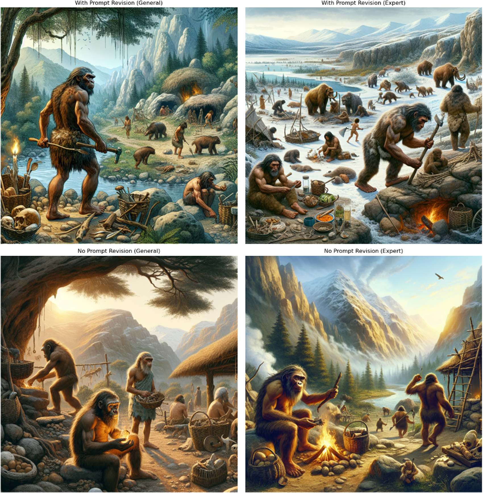{fig-align="center" width="100%"}

::: {.callout-important collapse="true"}
## Discussion

How can generative models such as LLMs be used in archaeology? What are some ethical concerns?
:::

## Data

We use in this lecture archaeological site detection as an example to illustrate the pipeline of AI in archaeology. This usually involves the following steps:

1.  **Prepare imagery.** Mosaick and georeference scenes.
2.  **Annotate.** Label every instance in GIS.
3.  **Tile.** Chips of 512/1024 pixels are a common choice, with center offset.
4.  **Split.** Ratios vary: 70/20/10 is a common start.
5.  **Balance background.** Particularly important for archaeologists. This can include hard negatives.
6.  **Augment.** Use flips, rotations, brightness, and mosaic, etc.
7.  **Train.** Start from pre-trained weights and default settings, then change one thing at a time.
8.  **Infer.** Run a sliding window across the scene with overlap, predict, map boxes back to scene coordinates, and remove duplicates.
9.  **Validation**. Import features in GIS; manually inspect. If possible, repeat the process.

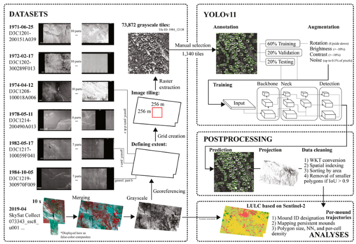{fig-align="center" width="100%"}

### Data Split

Typically, the data are split into three sets: training, validation, and test. Validation sets perform the initial testing on the model as it is being trained. Test sets test the difference between combos of hyperparameters.

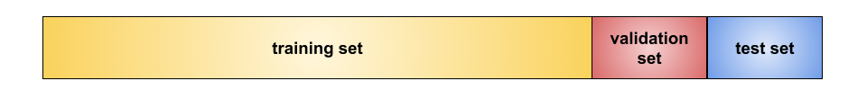{fig-align="center" width="100%"}

::: {.callout-important collapse="true"}
## Question

We trained a site detector to mounds in the Northern Fertile Crescent. Testing against the test set yields low loss. However, the detector peroformed pooly in the real world, resulting in many false positives. Which statement is true?

**A**. The test set should contain at least 10% of the original dataset.

**B**. The original dataset probably differs from real-life data.

**C**. This detector has a low recall.
:::

### Data Balancing

Archaeological data are usually highly imbalanced. Consider downsampling or upweight the majority class.

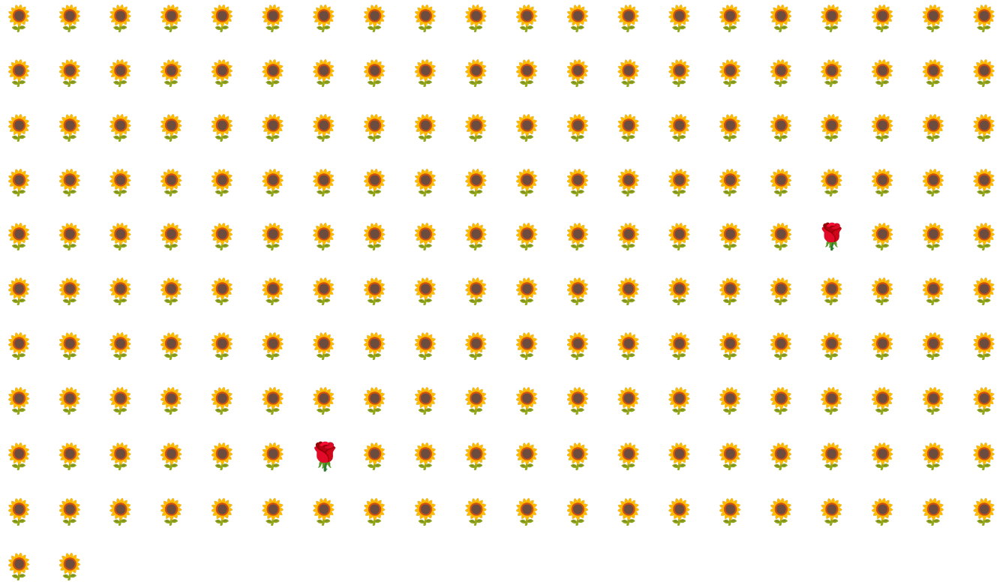{fig-align="center" width="100%"}

### Data Augmentation

Augmentation creates plausible variations of training images. @trier2018 used flips and 90° rotations. This is often done with [Albumentations](https://albumentations.ai/) library.

::: {.callout-important collapse="true"}
You train a CNN to assign Roman coins to reigns. Which augmentation should you leave out?

**A**. Small rotations

**B**. Small brightness changes

**C**. Mirror flips

**D**. Slight crops
:::

### Overfitting

Overfitting refers to a model that memorizes the exact pattern of the training set and it fails to generalize on new/real-world data.

::: {.callout-important collapse="false"}
## Demo

In the image below, orange circles represent locations of mounds in a Near Eastern location and the blue diamonds military forts. Draw shapes between these two classes; how would a fit, underfit, and overfit model classify?

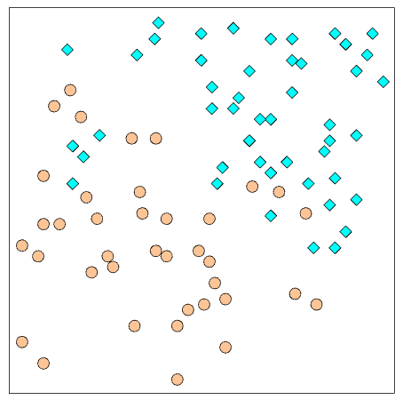{fig-align="center" width="80%"}
:::

We can plot the loss curves on both training and validation datasets to determine overfitting. In the diagram below, the increase in validation loss suggests that decreased ability to generalize.

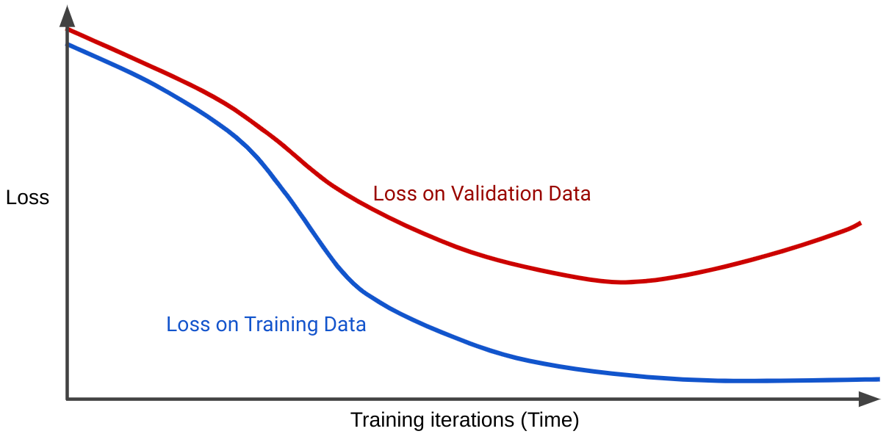{fig-align="center" width="100%"}

Now, to synthesize everything we have learned today, answer the final question below.

::: {.callout-important collapse="true"}
## Question

You train your CNN to assign Roman *denarii* to reigns. After 100 epochs, training accuracy is 99% and validation accuracy is 62%. Which step is most likely to reduce the overfitting?

A.  Add more convolutional layers
B.  Stop the training after only 60 epochs
C.  Train for 100 more epochs
D.  Remove random crops and brightness augmentations
:::
