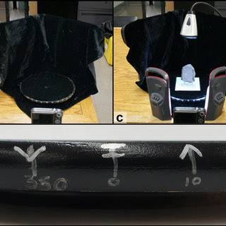
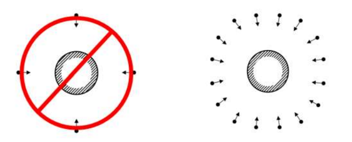

## Background and Objectives

The increasing ease of 3D model generation has rapidly transformed documentation in archaeology at scales ranging from artifacts to entire landscapes, while also offering exciting new research opportunities.

In this lab we will learn the basic steps involved in capturing digital images for the purpose of 3D modeling, processing those images using photogrammetry software, and analysis of resultant models.

We will use the popular photogrammetry software package [Metashape](Metashape.qmd), produced by the company Agisoft. The same basic steps we learn in this lab can be used to process many different kinds of imagery, including historic aerial photographs, archival photos of archaeological objects or excavations, and modern drone-acquired imagery (as we did a couple weeks ago).

::: callout-note
The 3D models we produce in this lab will not have any scale, but there are a variety of relatively straightforward methods for adding scales (see [further reading](3dmodel.qmd) below).
:::

Along with the instructions for 3D model generation below, you may find it helpful to consult this [series of YouTube videos](https://www.youtube.com/watch?v=qKWjPNlRK_I&list=PLZzVwXTSDAJ238A0AJJIIxr9wKV9nioO5) by Samatha Porter. She co-authored one of the readings of this week (@porter2016).

The software we will be using is the same as Lab 2.

::: callout-warning
Please make sure to complete the Metashape workflow before your 30-day trail license expires. If you need license assistance, please contact the instructors well ahead of the assignment deadline.
:::

## Photo Collection

For this step, you will need a scale bar that we provide during the lab. You can also choose to use our photogrammetry rig similar to the one in @porter2016.

{fig-align="center" width="65%"}

Further, you will need a digital camera or a smart phone.

Choose an artifact from the many options that we provide. Collect overlapping photographs of the object using the method [shown below](#photo_collection).

{#photo_collection fig-align="center" width="80%"}

Keep in mind:

1.  Keep images in focus

2.  Try to avoid too much background in the photos to cut down (alternatively, you can [mask images](3dmodel.qmd#mask) later)

3.  Ensure all surfaces to be modelled are visible in at least three photographs and that each image has at least 80% overlap with adjacent images

4.  Make sure that the camera moves as you collect images, collecting images from a similar distance to the object but from lots of different angles

5.  Ensure that the lighting on the object remain the same while you collect photos, without too much direct light or harsh shadows. You want nice, consistent, indirect light

Most objects will require you to collect at least two sets of images, one from the top and another from the bottom. With some objects this can be avoided, but it is in general necessary. Try to move the object only once if possible.
