## Introduction

In this lab, we will analyze the distribution of tells (mounded sites in the Near East, see @menze2012) and military fortifications in a region between [Mount Sinjar](https://en.wikipedia.org/wiki/Sinjar_Mountains) and Mosul (or Afar-Sinjar plains) in Northern Iraq. These tells mostly date to Late Chalcolithic to Early Bronze Age (*ca*. 5th-3rd millennia BC), and the forts were mostly built in Roman and later periods [@casana2023].

The Afar-Sinjar plains have previously eclipsed much of the academic attention compared to other parts of the Fertile Crescent. Our team has recently used computer vision methods (which we will discuss in Week 8) and high-resolution HEXAGON images to find *ca*. 400 sites in this region. We will be using a simplified vector database in this lab to study their distribution.

## File Downloads

You will only need to download a `.csv` for today's lab. This is a simplified table file that includes two classes: `mound` and `square` (fortification). Each site is represented by the `lat` and `long` of its centroid.

- [`lab4_sites_centroid.csv`](https://drive.google.com/file/d/1t5tRmTS6BBhkoVV0K0vVr-KgSsSG_2VP/view?usp=drive_link)

## Warm-up

Like in the [lecture](lecture_notes_w4), we will be using Google Earth Engine (GEE; setting up [here](GEE.qmd)) for most parts of this lab. In GEE code editor, start a new `File` in the left panel, save it ({width="10%"}) with descriptive path and file names. Press `Get link` and copy the shareable URL.

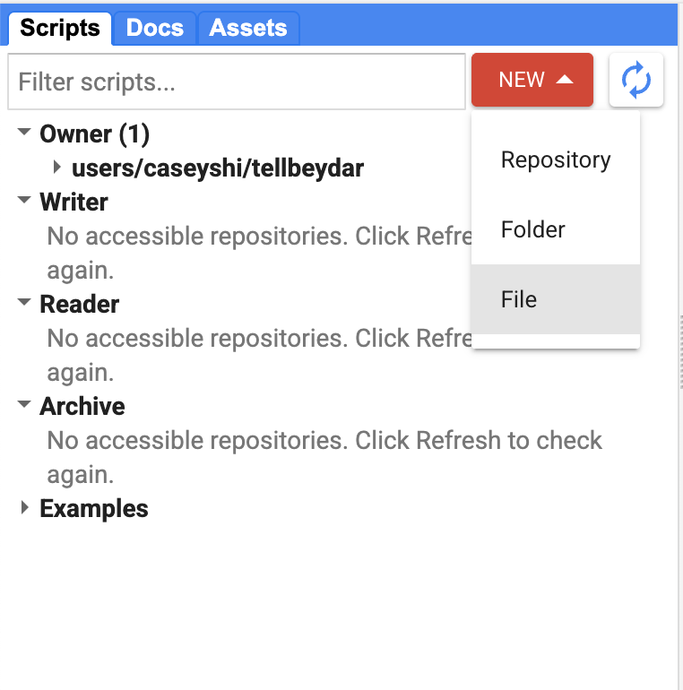{fig-align="center" width="80%"}

::: callout-important
## Question 1

Please copy and paste your GEE script link here.
:::

In the left panel, select `Assets` tab, click `New` -\> `CSV file (.csv)` to upload the site table you just downloaded.

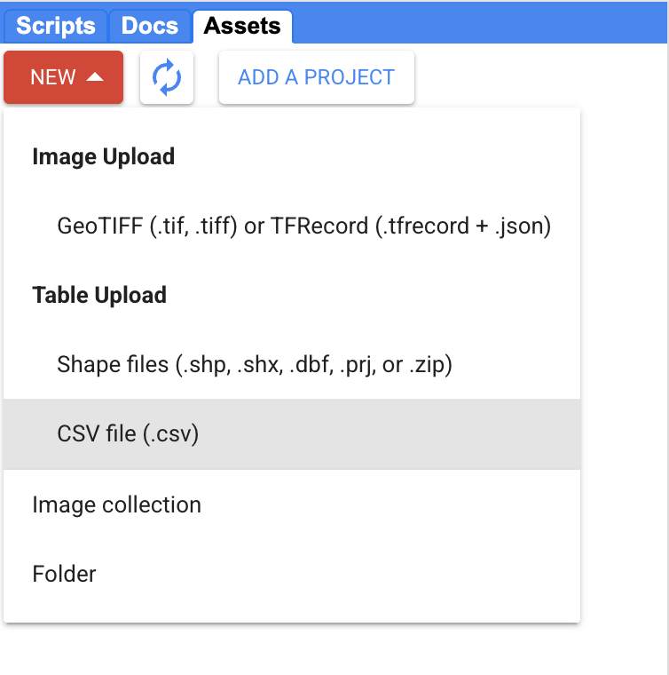{fig-align="center" width="80%"}

In the dialogue, define an `Asset Name` and assign `long` and `lat` to `X column` and `Y column`. Click `Upload`.

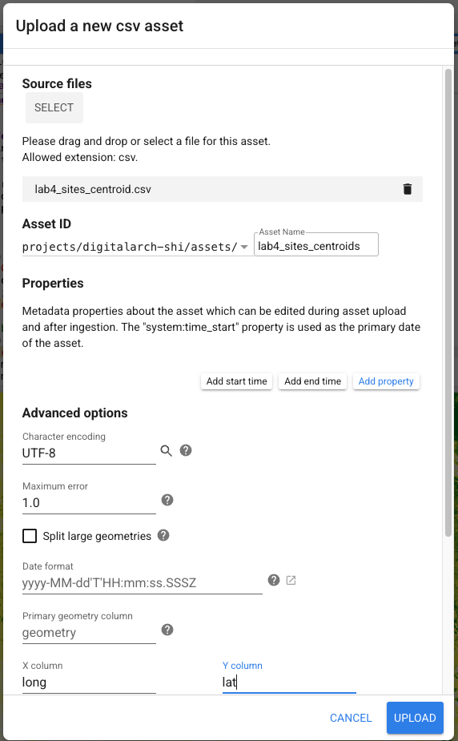{fig-align="center" width="80%"}

Click on the asset that you just added. Select `IMPORT` button from the top-right corner of the window.

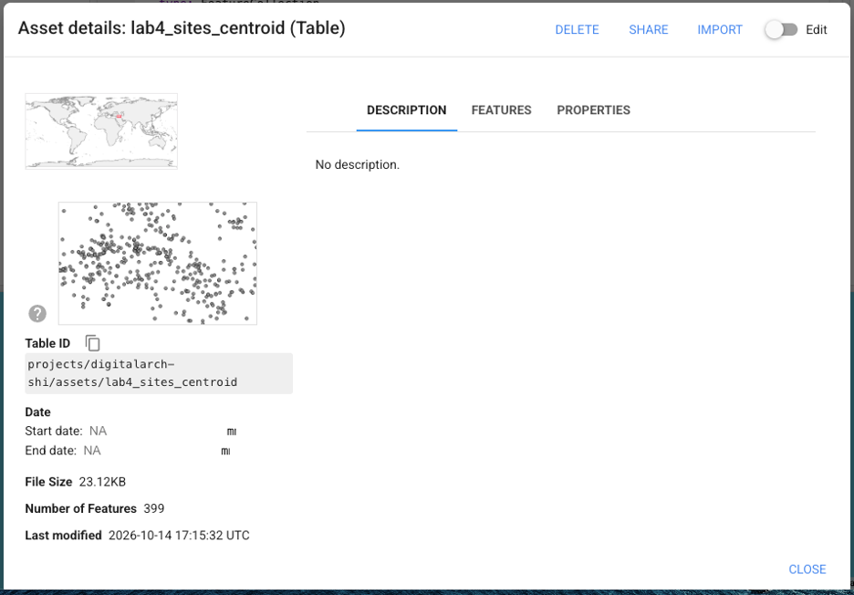{fig-align="center" width="80%"}

In the top panel of the code editor, you will now see a window called `Imports` where you can expand to see the detail of your table:

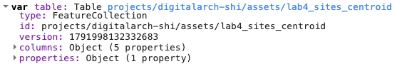{fig-align="center" width="80%"}

This table is now a `ee.FeatureCollection` object in GEE, meaning that it combines a variety of features where certain operations (like filtering) can be performed.

You can use the following code to visualize the centroids of the archaeological sites. Add the following code to your script and press `Run` on top.

``` javascript
// Adding points
var points = ee.FeatureCollection(table);
var squares = points.filter(ee.Filter.eq('class_name', 'square'));
var mounds = points.filter(ee.Filter.eq('class_name', 'mound'));

Map.centerObject(points, 9);
Map.addLayer(squares, {color: 'blue'}, 'Fortifications');
Map.addLayer(mounds, {color: 'red'}, 'Mounds');
```

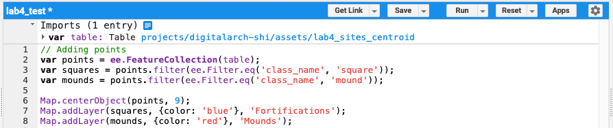{fig-align="center" width="80%"}

As before, let us define an area of interest (AoI) for our study region:

``` javascript
// Defining study region
var aoi = ee.Geometry.Rectangle([41.700, 35.650, 43.500, 36.700]);
Map.addLayer(aoi, {color: 'black'}, 'Study area');
```

You can use the `Layers` panel in the Map view to toggle sites and AoI, as well as to change opacity of each layer.

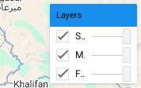{fig-align="center" width="40%"}

Further, you can open `Inspector` tab on the right panel, and click on anywhere on the map to check the detail there.

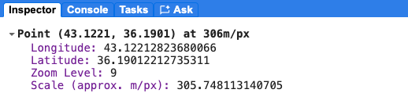{fig-align="center"}

The `Console` tab here will print out any information that you `print()` in the code.

## Adding MODIS Data

Just like in the change detection section of the [lecture](lecture_notes_w4.qmd#change-detection), we will be using multi-year MODIS (Moderate Resolution Imaging Spectroradiometer) data to investigate the relationship between the environment and site distributions. Following the example in the lecture notes, first create a variable `modisAll` that loads all MODIS scenes.

``` javascript
// Add MODIS data
var modisAll = ee.ImageCollection('MODIS/061/MOD13Q1');
```

Next, create `modisFiltered` to include only those scenes between 2010 and 2025 that touch our study region. We will only be using the NDVI (normalized difference vegetation index) for this exercise.

``` javascript
var modis = modisAll
  .filterDate('2010-01-01', '2026-01-01') // Note that the end date is not included
  .filterBounds(aoi)
  .select('NDVI');
```

Use `print()` and the `Console` to check how many modis scenes are used. You can use this function to check the size of other `ee.ImageCollection`.

``` javascript
print('# MODIS scenes in total:', modisAll.size());
```

::: callout-important
## Question 2

How many MODIS scenes, *after filtering*, are you using?
:::

### NDVI

To check if vegetation changes over time can predict archaeological site distribution, we can check NDVI in both autumn and spring seasons, and how that has changed over the years. To calculate an autumn NDVI "baseline" (not too dry, not too wet, only some plants), copy and paste the following code into your code editor:

``` {#autumn-NDVI .javascript}
// NDVI
var modisAutumn = modis.filter(ee.Filter.calendarRange(9, 12, 'month'));
var autumnNDVI = modisAutumn.mean().multiply(0.0001).rename('autumnNDVI');
Map.addLayer(autumnNDVI, {min: 0, max: 0.5, palette: ['brown', 'yellow', 'green']},
  'MODIS NDVI, autumn 2010-2025', true);
```

Visualize the autumn NDVI map, in which every pixel is the mean of all pixels in that same location from 2010 to 2025.

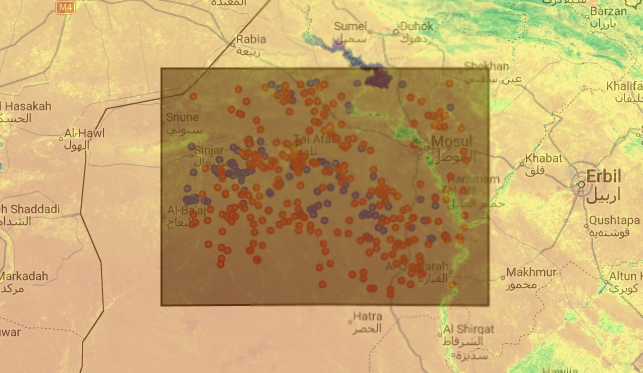{fig-align="center" width="80%"}

Now, follow the template of the [code block](#autumn-NDVI) above, create `modisSpring` that includes all 2010-2025 scenes from Feb to May (*i.e.*, `ee.Filter.calendarRange(2, 6, 'month')`. Calculate `springNDVI` and add it to the map with a proper layer name. \~4 lines of code are expected.

Then, use `print()` function and the `Console` to see how many scenes are used.

::: callout-important
## Question 3

Add the following code to your script and report the output in the `Console`:

``` javascript
print('# autumn scenes:', modisAutumn.size()); 
print('# spring scenes:', modisSpring.size());
```
:::

### Greenup

Now we are trying to see how different places in our study region "green up" in springtime differently: this usually has significant implications for site choice and agricultural practices. To do so, we will subtract the autumn NDVI of a given year from the following year's springtime peak. For example, to calculate the greenup of 2011 (`gu2011`), we will use max springtime NDVI from 2011 minus mean autumn NDVI.

It looks like this:

``` javascript
// calculating greenup 2011-2025
var gu2011 = modisSpring.filterDate('2011-01-01', '2012-01-01').max()
  .subtract(modisAutumn.filterDate('2010-01-01', '2011-01-01').mean()).rename('y2011');
```

Similarly, for greenup of 2012 (`gu2012`), we can write something like:

``` javascript
var gu2012 = modisSpring.filterDate('2012-01-01', '2013-01-01').max()
  .subtract(modisAutumn.filterDate('2011-01-01', '2012-01-01').mean()).rename('y2012');
```

For 2013, we have:

``` javascript
var gu2013 = modisSpring.filterDate('2013-01-01', '2014-01-01').max()
  .subtract(modisAutumn.filterDate('2012-01-01', '2013-01-01').mean()).rename('y2013');
```

Now, follow this template and complete the script that computes `gu2014` - `gu2025`; roughly 24 lines of code are needed.

After you are done, use the following to combine everything together and visualize the greenup of any given year:

``` javascript
// Stacking and visualizing greenup
var guAll = ee.Image.cat([
  gu2011, gu2012, gu2013, gu2014, gu2015, gu2016, gu2017, gu2018,
  gu2019, gu2020, gu2021, gu2022, gu2023, gu2024, gu2025
]).multiply(0.0001);

Map.addLayer(guAll.clip(aoi),
  {bands: ['y2025'], min: 0, max: 0.5, palette: ['brown', 'yellow', 'green']},
  'Greenup (2025)', true);
```

You should see something like this.

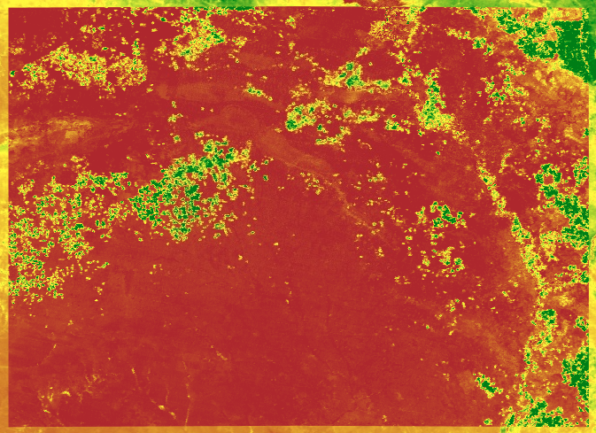{fig-align="center" width="80%"}

If you use `Inspector` tool from the right panel and click on a point within the study area, you will see a histogram featuring every year's greenup from 2011-2025.

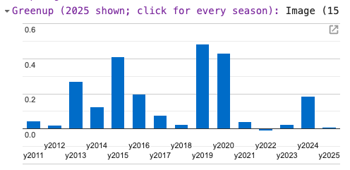{fig-align="center" width="80%"}

::: callout-important
## Question 4

Add the following code to your script and report its output in the `Console`:

``` javascript
print('# years in the stack:', guAll.bandNames().length());
```
:::

### Greenup Frequency

Finally, add these few lines to your script, calculating a "greenup frequency" from 2010 to 2025. This part basically calculates the percentage of the years that have dramatic greenup in the spring for any given pixel, meaning they are a "good year" for farmers. The higher the greenup frequency is, the better a chance a location has a good year in the past 15 years.

``` javascript
// Greenup frequency
var threshold = 0.2;
var greenupFreq = guAll.gt(threshold).reduce(ee.Reducer.mean()).rename('greenup_freq');
Map.addLayer(greenupFreq.clip(aoi), {min: 0, max: 1, palette: ['white', 'yellow', 'green']},
  'Greenup frequency');
```

You should be able to see something like the screenshot below. Given the palette defined `['white', 'yellow', 'green']`, the whiter parts (0) in this map mean that no difference of vegetation occur during any given year. Green parts represent the areas where vegetation reliably turns green, and farmers there can expect good harvests every year.

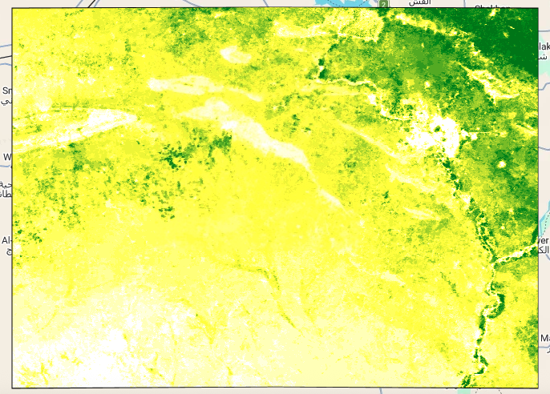{fig-align="center" width="80%"}

## Precipitation

We can also add precipitation data and see if site distribution matches the isohyets. We will be using the Rainfall Estimates from Rain Gauge and Satellite Observations ([CHIRPS](https://www.chc.ucsb.edu/data/chirps)) dataset that is also available in GEE.

Add this to your script:

``` javascript
// Rainfall
var chirps = ee.ImageCollection('UCSB-CHG/CHIRPS/PENTAD');
var rainfall = chirps
    .filterBounds(aoi)
    .filterDate('2020-01-01', '2025-01-01')
    .reduce(ee.Reducer.mean())
    .multiply(72)
    .clip(aoi)
    .rename('rainfall');
Map.addLayer(rainfall, {min: 150, max: 600, palette: ['#ffffcc','#41b6c4','#253494']}, 'Annual mean precipitation')
```

This may take a while to load. You should now be able to see annual mean precipitation averaged from five-year data.

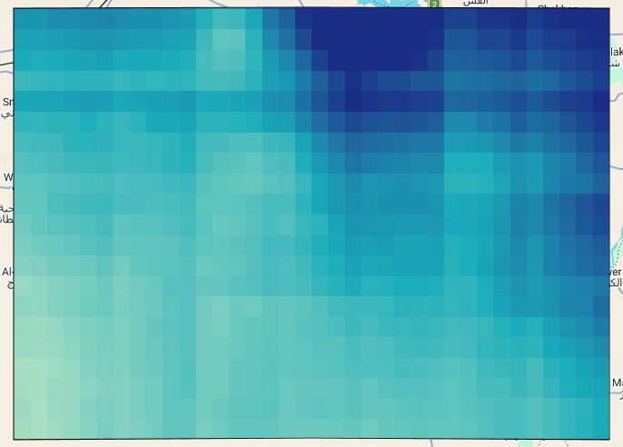{fig-align="center" width="80%"}

## Synthesis

Now, feel free to add the site centroids on top to see if they match with any the environmental data we just produced:

``` javascript
// Adding points on top
var points = ee.FeatureCollection(table);
var squares = points.filter(ee.Filter.eq('class_name', 'square'));
var mounds = points.filter(ee.Filter.eq('class_name', 'mound'));

Map.centerObject(points, 9);
Map.addLayer(squares, {color: 'blue'}, 'Fortifications');
Map.addLayer(mounds, {color: 'red'}, 'Mounds');
```

Feel free to change toggle on and off different layers and change opacity of these layers.

::: {#question5 .callout-important}
## Question 5

For mounds and the square fortifications, describe how the sites are differently distributed. How does the distribution of mounds differ from that of fortifications in this region? Turn on the autumn NDVI, spring NDVI, greenup frequency, and mean annual rainfall layers, one at a time. For each site type, which environmental layer (if any) seems to explain its distribution better?
:::

Finally, let us stack all bands together and read the values for each of the site, so we can export our data. Add the following code to your script:

``` javascript
// Stacking points data
var env = autumnNDVI.focalMean({radius: 2000, units: 'meters'})
  .addBands(springNDVI.focalMean({radius: 2000, units: 'meters'}))
  .addBands(greenupFreq.focalMean({radius: 2000, units: 'meters'}))
  .addBands(rainfall)
  .addBands(ee.Image.pixelLonLat());            // adds longitude and latitude

var siteValues = env.sampleRegions({
  collection: points,
  properties: ['class_name'],
  scale: 250
});

// Export

Export.table.toDrive({
  collection: siteValues,
  description: 'sites_environment',
  fileFormat: 'CSV',
  selectors: ['class_name', 'autumnNDVI', 'springNDVI', 'greenup_freq',
              'rainfall', 'longitude', 'latitude']
});
```

Locate `Tasks` tab from the right panel and `RUN` the `sites_environment` task.

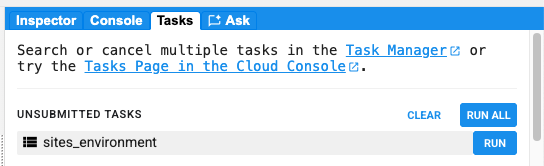{fig-align="center" width="80%"}

In the pop-up window, leave `Drive folder` blank, so GEE will save the file to the root of your Google Drive. Change `Filename` to a reasonable name such as `DigitalArch_lab4_name_output1`. `File format` should be `CSV`. Press `RUN`.

Wait for a few moments before the rotating gear symbol turns to a gray tick (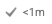{width="10%"}). This may take a while. After the task is done, go to your Google Drive and download the `csv` file you just created.

::: callout-tip
You may need to switch your Google account to the one hosting your GEE cloud project before downloading the `csv` file.
:::

The first few rows of the csv file should look like this:

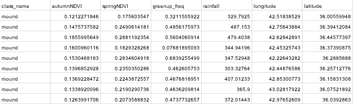{fig-align="center" width="100%"}

### Statistical Analyses (Optional)

@bauer2018 and @howey2026 have both used p-values to test whether a class of sites (mounds or square forts) is significantly associated with an environmental variable. We can do the same to test the patterns you observed in [Question 5](#question5).

In this case, we will be using a simple [Mann-Whitney U](https://en.wikipedia.org/wiki/Mann%E2%80%93Whitney_U_test) Test for two independent datasets (mounds and square forts). For each measurement (autumn NDVI, spring NDVI, greenup frequency and mean annual rainfall), the test asks whether values at one type of site tend distribute differently than at the other.

To do that, we will be using a simple online calculator like [this](https://www.socscistatistics.com/tests/mannwhitney/calculator/). All you need to do is to plug values from the mound class to group 1, and the square class to group 2.

For example, to compare whether autumn NDVI at mound sites is statistically different from that at forts, simply copy and paste all mounds' autumnNDVI data (cells `B2`:`B269` in the `.csv` file) to Group 1 in the online calculator, and all forts' autumnNDVI data (`B270`:`B400`) to Group 2. Like this:

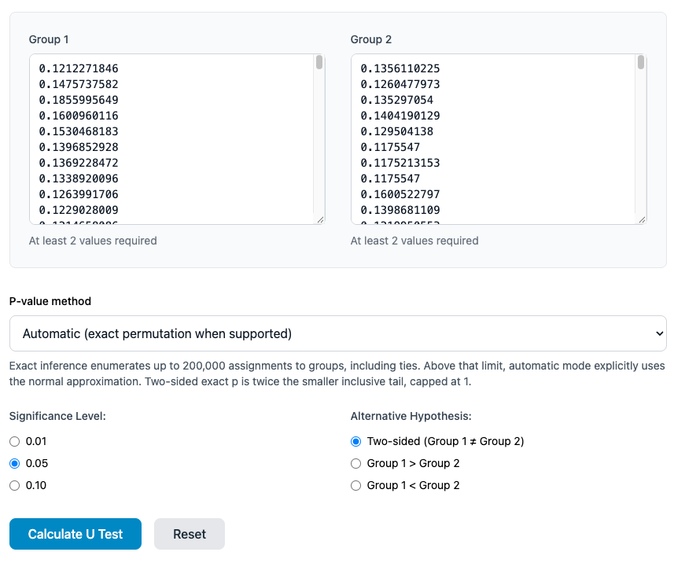{fig-align="center"}

Select `0.05` for the `Significance Level` and `Two-sided` for the `Alternative Hypothesis`. This means that we will say that the distributions of the two groups are only significantly different when *p*-value (probability) is lower than 0.05 or 5%.

Select `Calculate U Test` and see the results.

In this case, *p*-value is 0.423, meaning that there is a 42% chance that these two groups could be from the same population. In other words, autumn NDVI cannot reliably help us distinguish mounded sites from forts.

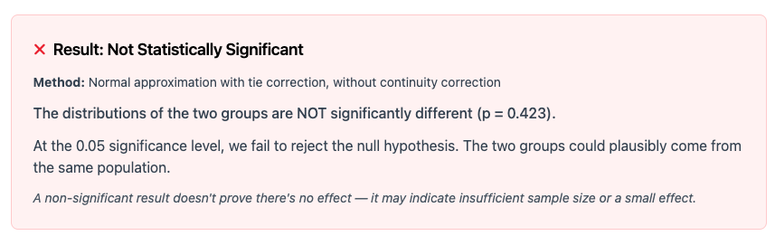

::: callout-important
## Bonus Question

Run a Mann–Whitney U test comparing mounds and fortifications on spring NDVI (`springNDVI`), greenup frequency (`greenup_freq`) and mean annual rainfall (`rainfall`). Report the two-tailed p-value for each.

**a**. Which of these variables, if any, differ significantly between the two types of site (p \< 0.05)?

**b**. Do these results agree with what you observed in Question 5?

**c**. In your opinion, what might these results suggest about how mounds and fortifications were sited?
:::
