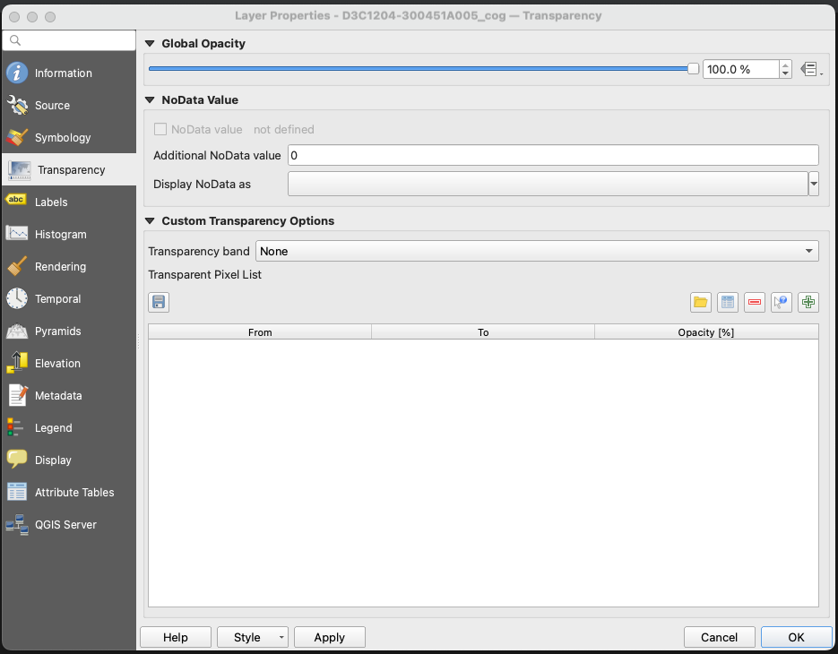
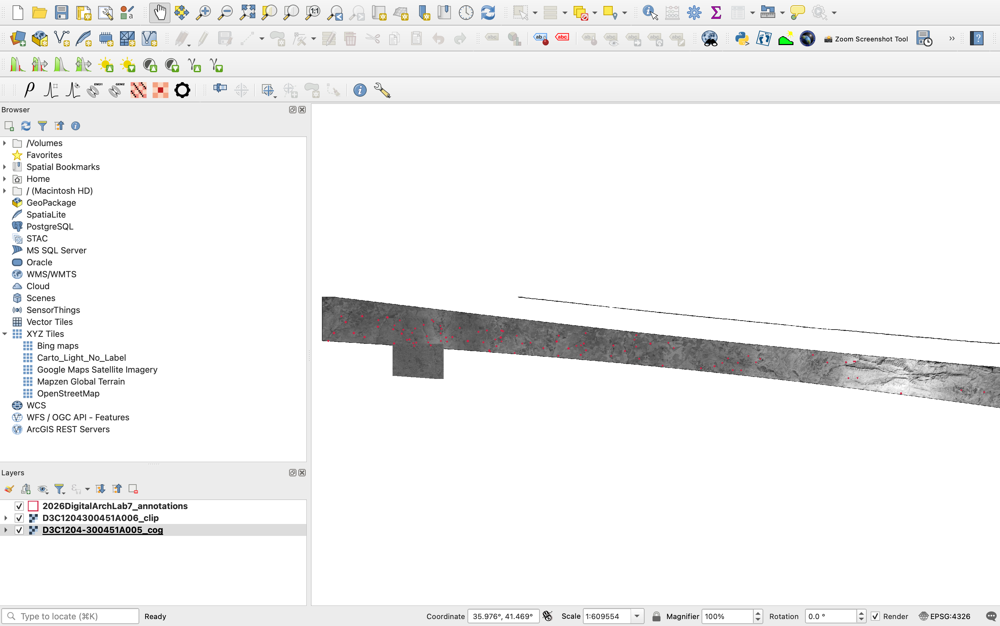

## Objectives

In this lab, we will be attempting to train a [YOLO](https://docs.ultralytics.com/) object detector to find archaeological sites in a HEXAGON scene in the Northern Fertile Crescent. To do so, we will use an alpha version of ODEON (**O**bject **D**etection on **E**arth **O**bservation for a**N**tiquity) that our team develops to streamline data preparation, hyperparameter tuning, transfer learning, and inference.

## File Downloads

For this lab, you will need to download the following six files. Please make sure to place all files in one folder.

::: callout-caution
Given the size of the HEXAGON scenes, please make sure that your workstation has at least 30GB of storage. Otherwise, consider using a flash drive.
:::

1.  [`ODEON-0.3.zip`](https://drive.google.com/file/d/1VGWZhtzEGixke7E9ghGh-heIwcD-0EMS/view?usp=sharing): This is a recent version of the ODEON tool that we will be using. Unzip the file after you download it.

2.  [`2026DigitalArchLab7_annotations.geojson`](https://drive.google.com/file/d/153wY5reYWXqWbaUnyXZ9Bq3SVBhUHnKJ/view?usp=sharing): A `.geojson` file that contains the labels (positive examples) of archaeological mounds in our study area.

3.  [`D3C1204-300451A005_cog.tif`](https://drive.google.com/file/d/1cYAqVL9OsOX9HDfd2tXU9A8O76uZVrMs/view?usp=drive_link): One orthorectified HEXAGON scene that covers part of Northern Iraq.

4.  [`D3C1204300451A006_clip.tif`](https://drive.google.com/file/d/16CT4t8alGnRsduXW7PHlsM7yJhoQqzrm/view?usp=drive_link), [`D3C1204300451A006_clip.tfw`](https://drive.google.com/file/d/1jCrDjdN11aeRy-MvQskk5yZ856nXOnfX/view?usp=drive_link), and [`D3C1204300451A006_clip.tif.ovr`](https://drive.google.com/file/d/1n-2upGPmqi1hOqvV9z__8vi4oVb7t1jh/view?usp=drive_link): A clipped raster for inference/prediction. `tfw` and `ovr` store coordinates and pyramids for the quick visualization of the raster in QGIS. Make sure to group these files in one folder with a name such as `Lab7_inference`.

## Overview

Open a new QGIS project and load the `geojson` label and the two `.tif` files. Zoom in on some of the features in the `geojson` file and examine the mounds. For `D3C1204-300451A005_cog.tif`, you can get rid of the black border by adding 0 as `Additional NoData Value` in Layer Properties -\> Transparency.

{fig-align="center" width="80%"}

You can also change the Symbology of the annotation layer to make it more visible. The three files should look something like this in QGIS:



We will be using the annotations and the `D3C1204-300451A005_cog.tif` to create a training dataset, which involves clipping around each of the labeled examples. ODEON will help handle this.

After training our model, we will run it on `D3C1204300451A006_clip.tif` to find features there.

## Setting Up ODEON

We will be using [uv](https://docs.astral.sh/uv/getting-started/installation/), a small tool that installs Python and manages dependencies on both macOS and Windows, to set up ODEON.

::: panel-tabset
## macOS

To install uv in macOS, use `curl` to download the script and execute it with `sh` in Terminal:

``` bash
curl -LsSf https://astral.sh/uv/install.sh | sh
```

In Terminal, navigate to your ODEON folder by using `cd`; make sure to replace the directory below with the correct path in your computer.

``` bash
cd /Users/Downloads/odeon-feature-web-frontend
```

Finally, run ODEON program by using `uv`:

``` bash
uv run --python 3.13 --with-requirements requirements.txt main.py
```

Wait for ODEON to run. This may take a while.

## Windows

In Windows, open PowerShell, and use `irm` to download the script and execute it with `iex`:

``` bash
powershell -ExecutionPolicy ByPass -c "irm https://astral.sh/uv/install.ps1 | iex"
```

In PowerShell, navigate to the directory of ODEON by using `cd`. Replace the folder path with yours:

``` bash
cd C:\Users\Username\Documents\odeon-feature-web-frontend
```

Finally, run ODEON program by using `uv`:

``` bash
uv run --python 3.13 --with-requirements requirements.txt main.py
```

Wait for ODEON to run. This may take a while.
:::
