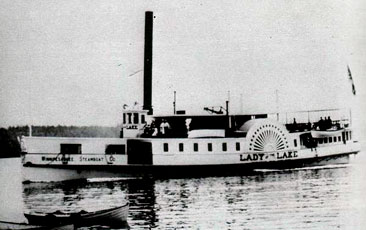

## Objectives

In this lab, we will be using side-scan sonar images and publicly available bathymetric data to find wrecks in Lake Morey, VT, and Lake Winnipesaukee, NH. One of these shipwrecks belonged to the famed steamship [*Lady of the Lake*](#lady), which was retired in 1893 and sunk near the Glendale Docks. Can you uncover the secrets of ["The Lady?"](https://www.idivenewengland.com/dive-sites/nh/lady-of-the-lake)

{#lady fig-align="center" width="60%"}

## File Downloads

For this week's lab, we will be mostly dealing with `MBTiles` files. These are [SQLite](https://sqlite.org/) databases that can contain both raster and vector [tilesets](https://docs.mapbox.com/help/glossary/tileset/). `MBTiles` can be loaded in QGIS just like any other raster files.

Download the following files for [Lake Morey, VT](https://www.google.com/maps/place/Lake+Morey,+Fairlee,+VT+05045/data=!4m2!3m1!1s0x4cb4ead83bb44329:0x8853df28983cc2ae?sa=X&ved=1t:242&ictx=111) and save them in a folder such as `Lab8_Morey`:

- Bathymetry data derived from CSV points provided by the state of VT: [`lakemoreyvt_bathymetry_m.tif`](https://drive.google.com/file/d/1ErU56Z3_A8cJeGXhwmUuP-AZenqAG9KO/view?usp=drive_link) and [`lakemoreyvt_bathymetry_m.tfw`](https://drive.google.com/file/d/1C8gGB9Do9xl6APMfS--nuSC25dZS0L17/view?usp=drive_link)

- Sonar mosaics using Humminbird side scanner from 18 and 25 June 2024: [`LakeMorey18June2024.mbtiles`](https://drive.google.com/file/d/11E-_r2evBxwXf4U2QS6WQHKMmjwbJbd6/view?usp=drive_link) and [`LakeMorey25June2024.mbtiles`](https://drive.google.com/file/d/1wx3QmTJPCjO5OalR1nSRKFIQy3HdeCQP/view?usp=drive_link)

- Sonar mosaic from our blue boat: [`Canoe14Oct26_BlueBoat47.mbtiles`](https://drive.google.com/file/d/16VFCxgrmPBPDquBlMkgTPO3yVf3qI0Rq/view?usp=drive_link)

Next, download these files for [Lake Winnipesaukee](https://en.wikipedia.org/wiki/Lake_Winnipesaukee) in New Hampshire and store them in a separate folder:

- Sonar mosaics of Lady of the Lake plus a few other interesting wrecks: [`LadyofLake23.mbtiles`](https://drive.google.com/file/d/1e_GcJOmFBke_nd1nTaLMj-6vsindVbHG/view?usp=drive_link), [`ScampBarge30.mbtiles`](https://drive.google.com/file/d/1hMyLU9l7pQoK66UT_QnuBBhMdCyTdaFv/view?usp=drive_link), [`TrainCar8.mbtiles`](https://drive.google.com/file/d/1AkDTf8rUq9SusXEEUL-cYpkhpv-Tn6Q7/view?usp=drive_link), and [`TugBoat22.mbtiles`](https://drive.google.com/file/d/1z6Y5N0I9BbmRp9qKv2mKeiWB5F-zjler/view?usp=drive_link)

- Bathymetric lidar of an underwater peninsula near Weirs Beach (filtered for ground): [`weirs_bathymetric_lidar_ground.tif`](https://drive.google.com/file/d/1KeUvGOMevqYY3mjeJq5NqctikH7-9E_D/view?usp=drive_link)

- Sonar mosaics of that underwater peninsula: [`Weirs171632.mbtiles`](https://drive.google.com/file/d/1hYoCvKt8B-ooXJNqJAZG64uLo1SwcQrQ/view?usp=drive_link)

- 40m contour interval bathymetric lines from the State of NH: [`Winnepsaukee_NHState_Bathymetry_Lines.zip`](https://drive.google.com/file/d/1vYk56Hv-NfmQg-Vkk1pk3-lKEtKS08t5/view?usp=drive_link)

## Lake Morey, VT

Add all Lake Morey files to QGIS. Group these layer together. For `lakemoreyvt_bathymetry_m.tif`, change the Symbology `Render Type` to Hillshade. For Z Factor, select 3, so that elevation difference is more exaggerated.

{fig-align="center" width="100%"}

In the sonar data collected on 25 June, 2024, locate a canoe near the coordinates `-8032333.33,5452655.77`.

{fig-align="center" width="100%"}

Toggle on and off other layers to check if you can see the canoe there.

::: callout-important
## Question 1

Can you see the canoe in the bathymetric layer or the sonar data collected by the Blue Boat? Using the bathymetry, measure the depth at which this canoe was found. How long is this canoe?
:::

There are other possible shipwrecks around. Go to `-8032160.804,5452708.113`, and you can see a wreck in the `LakeMorey25June2024` layer.

{fig-align="center" width="100%"}

::: callout-important
## Question 2

Carefully examine `LakeMorey18June2024` and `LakeMorey25June2024`. Identify at least three more shipwrecks. Report with coordinates and screenshots. Can you see them in both layers? Based on your understanding of side-scan sonar, why or why not?
:::

Once you are ready, let us move on to Lake Winnipesaukee, where much more underwater archaeology awaits.
