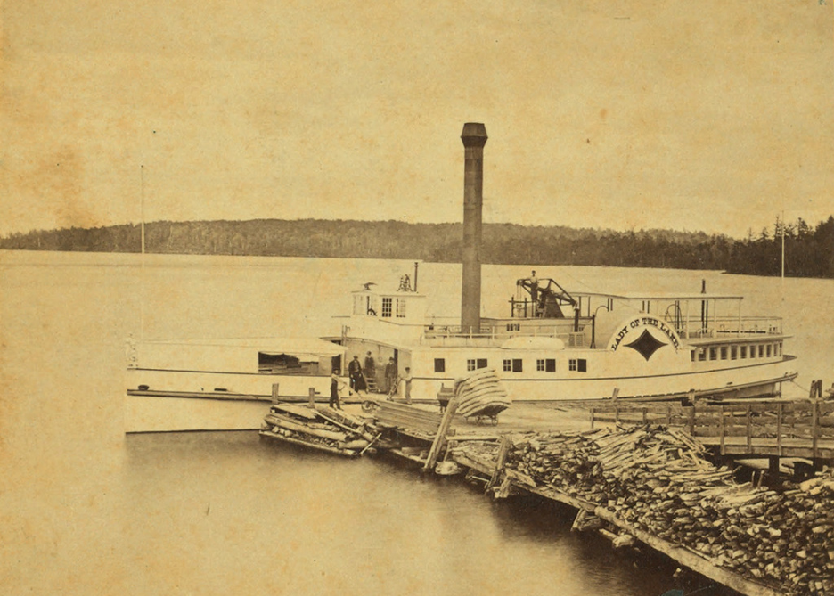
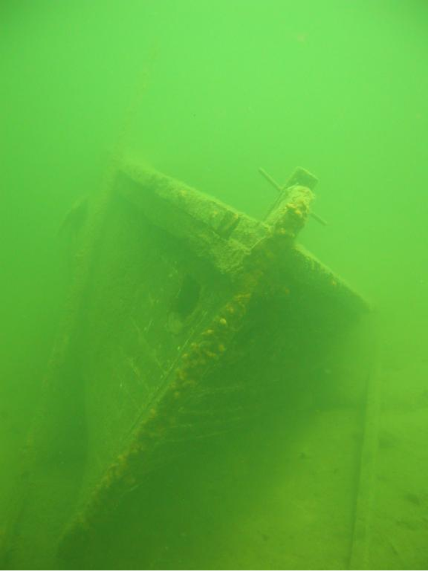
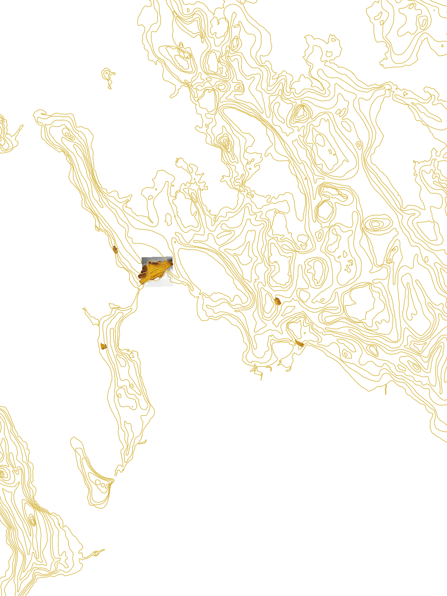

## Objectives

In this lab, we will be using side-scan sonar images and publicly available bathymetric data to find wrecks in Lake Morey, VT, and Lake Winnipesaukee, NH. One of these shipwrecks belonged to the famed steamship [*Lady of the Lake*](#lady), which was retired in 1893 and sunk near the Glendale Docks. Can you uncover the secrets of ["The Lady?"](https://www.idivenewengland.com/dive-sites/nh/lady-of-the-lake)

{#lady fig-align="center" width="100%"}

## File Downloads

For this week's lab, we will be mostly dealing with `MBTiles` files. These are [SQLite](https://sqlite.org/) databases that can contain both raster and vector [tilesets](https://docs.mapbox.com/help/glossary/tileset/). `MBTiles` can be loaded in QGIS just like any other raster files.

First, download these files for [Lake Winnipesaukee](https://en.wikipedia.org/wiki/Lake_Winnipesaukee) in New Hampshire and store them in a separate folder such as `Lab8_Winni`:

- Sonar mosaics of Lady of the Lake plus a few other interesting wrecks: [`LadyofLake23.mbtiles`](https://drive.google.com/file/d/1e_GcJOmFBke_nd1nTaLMj-6vsindVbHG/view?usp=drive_link), [`ScampBarge30.mbtiles`](https://drive.google.com/file/d/1hMyLU9l7pQoK66UT_QnuBBhMdCyTdaFv/view?usp=drive_link), [`TrainCar8.mbtiles`](https://drive.google.com/file/d/1AkDTf8rUq9SusXEEUL-cYpkhpv-Tn6Q7/view?usp=drive_link), and [`TugBoat22.mbtiles`](https://drive.google.com/file/d/1z6Y5N0I9BbmRp9qKv2mKeiWB5F-zjler/view?usp=drive_link)

- Bathymetric lidar of an underwater peninsula near Weirs Beach (filtered for ground): [`weirs_bathymetric_lidar_ground.tif`](https://drive.google.com/file/d/1KeUvGOMevqYY3mjeJq5NqctikH7-9E_D/view?usp=drive_link)

- Sonar mosaics of that underwater peninsula: [`Weirs171632.mbtiles`](https://drive.google.com/file/d/1hYoCvKt8B-ooXJNqJAZG64uLo1SwcQrQ/view?usp=drive_link)

- 40m contour interval bathymetric lines from the State of NH: [`Winnepsaukee_NHState_Bathymetry_Lines.zip`](https://drive.google.com/file/d/1vYk56Hv-NfmQg-Vkk1pk3-lKEtKS08t5/view?usp=drive_link)

- Shapefile of known wrecks: [`winni_wrecks_shp.zip`](https://drive.google.com/file/d/1RloCzr6tQBSt4pbT-PbnofQX5jBVxEkL/view?usp=drive_link)

Download the following files for [Lake Morey, VT](https://www.google.com/maps/place/Lake+Morey,+Fairlee,+VT+05045/data=!4m2!3m1!1s0x4cb4ead83bb44329:0x8853df28983cc2ae?sa=X&ved=1t:242&ictx=111) and save them in a folder such as `Lab8_Morey`:

- Bathymetry data derived from CSV points provided by the state of VT: [`lakemoreyvt_bathymetry_m.tif`](https://drive.google.com/file/d/1ErU56Z3_A8cJeGXhwmUuP-AZenqAG9KO/view?usp=drive_link) and [`lakemoreyvt_bathymetry_m.tfw`](https://drive.google.com/file/d/1C8gGB9Do9xl6APMfS--nuSC25dZS0L17/view?usp=drive_link)

- Sonar mosaics using Humminbird side scanner from 18 and 25 June 2024: [`LakeMorey18June2024.mbtiles`](https://drive.google.com/file/d/11E-_r2evBxwXf4U2QS6WQHKMmjwbJbd6/view?usp=drive_link) and [`LakeMorey25June2024.mbtiles`](https://drive.google.com/file/d/1wx3QmTJPCjO5OalR1nSRKFIQy3HdeCQP/view?usp=drive_link)

- Sonar mosaic from our blue boat: [`Canoe14Oct26_BlueBoat47.mbtiles`](https://drive.google.com/file/d/16VFCxgrmPBPDquBlMkgTPO3yVf3qI0Rq/view?usp=drive_link)

## Lake Winnipesaukee

There are a large number of documented shipwrecks and other features in Lake Winnipesaukee. The shapefile `winni_wrecks_shp.zip` provides information on previously mapped wrecks, and our team has collected sidescan sonar data over several of them. In this portion of the lab you should try to find as many of these shipwrecks and other features as possible.

{fig-align="center" width="80%"}

Import all Lake Winnipesaukee files, including the shapefile, in QGIS. Using a satellite basemap in this case might help you navigate.

{alt="Part of the database (sans basemap)" fig-align="center" width="100%"}

Zoom in to different parts with sonar data. Using the shapefile `Attribute Table`, you can find descriptions of different wrecks.

{fig-align="center" width="80%"}

::: callout-tip
Remember that you can use `Identify Features` tool ({width="5%"}) to identify wrecks in the shapefile.
:::

::: callout-important
## Question 1

Find, with screenshots, the steamship Lady of the Lake, a tugboat, a SCAMP boat, a flat-bottomed barge near the SCAMP, and finally a railroad boxcar.
:::

## 
