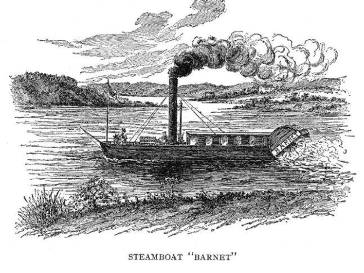
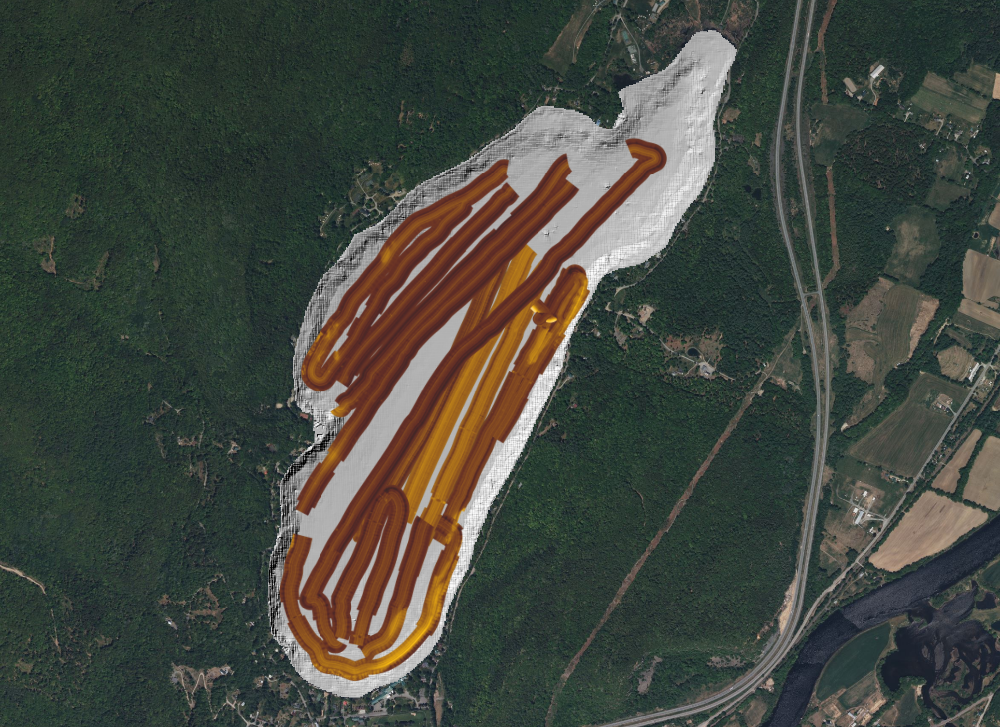
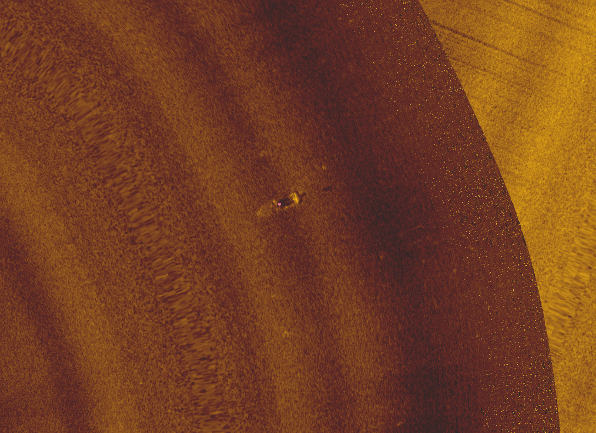

## Unknown Depths

Unlike Lake Winnipesaukee, the bottom of Lake Morey has never been well surveyed and it is unknown how many shipwrecks or other features are hidden in its murky depths.

The lake is named for inventor Samuel Morey (1762-1843), who according to local legend, used Lake Morey (then known as Lake Fairlee) as the testing site for his invention of a steam powered boat. Although Robert Fulton is often given credit as the inventor of the steamboat, Morey received several pattens for his steam powered engines and paddle wheel driven boats in the 1790s (now in Rauner Library here at Dartmouth). He tried to sell his boat to investors at an exposition in New York in 1797, but was unsuccessful. A few years later, Fulton would use financial backers from the same exposition to invent his own steam boat, and Morey claimed until his death that Fulton has stolen his design. His boat, the Aunt Sally, once steamed up and down the Connecticut River, but he was so depressed at his failure to sell his invention and so angry about it having been stolen, that in 1821, he is reported to have brought the Aunt Sally into Lake Morey and intentionally scuttled it. To this day, the veracity of the story and the location of the wreck if true is unknown.

{fig-align="center" width="80%"}

Your mission is to examine the side scan sonar data for Lake Morey and see if you can find any shipwrecks or other features that are potential candidates for the Aunt Sally.

## Possible Wrecks

Add all Lake Morey files to QGIS. Group these layer together. For `lakemoreyvt_bathymetry_m.tif`, change the Symbology `Render Type` to Hillshade. For Z Factor, select 3, so that elevation difference is more exaggerated.

{fig-align="center" width="100%"}

In the sonar data collected on 25 June, 2024, locate a canoe near the coordinates `-8032333.33,5452655.77`.

{fig-align="center" width="100%"}

Toggle on and off other layers to check if you can see the canoe there.

::: callout-important
## Question 2

Can you see the canoe in the bathymetric layer or the sonar data collected by the Blue Boat? Using the bathymetry, measure the depth at which this canoe was found. How long is this canoe?
:::

There are other possible shipwrecks around. Go to `-8032160.804,5452708.113`, and you can see a wreck in the `LakeMorey25June2024` layer.

{fig-align="center" width="100%"}

::: callout-important
## Question 3

Carefully examine `LakeMorey18June2024` and `LakeMorey25June2024`, ideally in a systematic fashion. Identify at least three more shipwrecks. Report with coordinates and screenshots. Can you see them in both sonar mosaics? Based on your understanding of side-scan sonar, why or why not?
:::

Once you are done, answer the following questions based on your readings.

::: callout-important
## Question 4

What are the strengths and weaknesses of various methods used by @ferentinos2020 to document a shipwreck in Greece? How well do you think these methods would work on the wrecks in Lake Winnipesaukee or Lake Morey?
:::

::: callout-important
## Question 5

Both @grøn2021 and @davis2024 use different methods to document submerged prehistoric sites. What are the relative advantages of each? Would any of these techniques work for site documentation in New England?
:::
